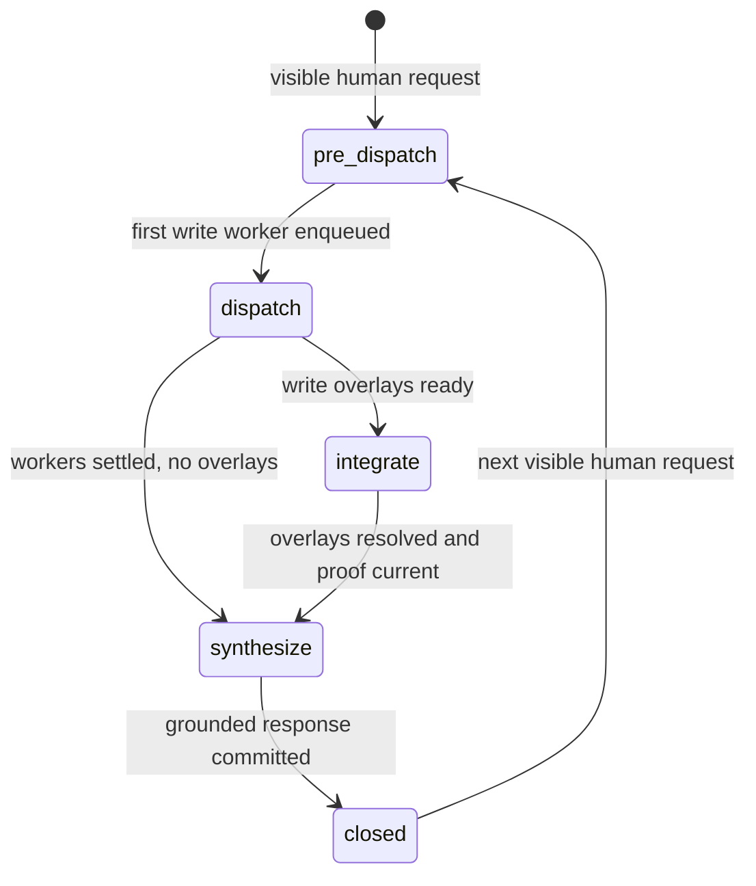

# Coordination

Coordination lets one session use parallel workers without sharing scratch state, racing writes into the project tree, or asking the human to reconstruct what happened from several transcripts.

**See also:** [Architecture](architecture.md#coordination-planes) · [Session](session.md) · [Tools](tools.md#worker-scope-coordination) · [Grounding](grounding.md) · [Worker result contract](worker-result-contract.md)

**Machine truth:** surface routing in `lycaon/config/packs/painted-wolf/platform/host/coordinator-flow.yaml` and `coordinator-surfaces.yaml`, compiled by `lycaon/internal/coordinator/surface/` · workers in `lycaon/internal/worker`, `lycaon/internal/workerrecords`, `lycaon/internal/workerplan`, and `lycaon/internal/spawn` · worker workspaces in `lycaon/internal/sourceworkspace`

---

## Why workers are isolated

A worker is a durable named collaborator in a root session, backed by its own child session and, for write work, its own private workspace across rounds. Each round runs against the worker's standing brief and any instructions for that round, records its own tool calls and evidence, and delivers a structured completion envelope keyed by an immutable result handle. Workers do not share mutable transcript scratch, a common write tree, an implicit understanding of sibling intent, or authority merely because the coordinator has it. Each worker's `@scratch` folder is private to it, so what the coordinator needs comes back in the result or a message, not as a scratch path.

Read workers may inspect the full attached project; their declared paths name the assignment focus, not an access-control boundary. Write workers operate on private views, and the host promotes observed changes after verification and conflict review, or rejects or shelves them explicitly.

Isolation makes both collaboration and integration explicit: a worker can deliver a round, receive follow-up instructions in the same conversation, message the coordinator while working, or pause on a blocking decision without mixing child exploration into the parent transcript.

## Four planes

| Plane | Question | Durable authority | Human surface |
|-------|----------|---------------|---------------|
| **Progress** | What work remains in this root session? | Session checklist | Progress strip |
| **Findings** | What observation should other workers or the coordinator know? | Findings store | Worklog and review surfaces |
| **Board** | What is true about the project and active work now? | Query-time projection | Board/summary views |
| **Blueprints** | What governing plan has been reviewed? | Project overlay file | Blueprint editor and cards |

A finding does not close a progress item. A checklist is not a governing plan. The board is derived orientation, not a writable notebook.

Progress uses a constrained Markdown checkbox grammar: models author and revise it reliably while one strict parser produces typed rows. The markers are a declared wire syntax, not natural-language classification. Findings require a resolvable evidence or path reference, which keeps the shared plane grounded.

---

## Execution modes

The coordinator changes behavior according to machine state, not the wording of the request:

| Mode | Purpose | Mutation behavior |
|------|---------|-------------------|
| **Investigate** | Understand the request and project, perform bounded direct work, decide whether parallelism helps | The project-scoped mutation surface is reachable only after an explicit request |
| **Orchestrate** | Dispatch, monitor, reconcile, and integrate workers | Write work belongs to worker overlays; the coordinator routes and promotes |
| **Wrap up** | Reconcile proof and produce one grounded result | No new product mutation |

Investigate is the ordinary starting mode. Dispatching the first write worker opens the orchestrated batch. Wrapup becomes eligible only when worker, overlay, progress, and evidence state permit it.

The host compiles the current coordinator surface from workflow phase, worker state, pending overlay state, closeout obligations, and session posture. `coordinator-flow.yaml` is a first-hit decision table over those facts. Posture reaches it through `dispatch_on: posture`: a read-only posture takes the `observe_` counterpart of any destination that would otherwise carry a mutating tool, so the routing holds and only the destination changes. A tool absent from the compiled surface cannot be deferred or requested into the turn; a name the turn does not carry is refused as `COORDINATOR_TOOL_DENIED` before the profile is consulted.

A phase the **host holds**, one waiting on its obligations or topology legs, parks the coordinator, and host-opened turns in it end at their first tool boundary. A person can still ask something meanwhile. Their turn routes to `await_host` whatever surface the phase declares: a read-only surface with no report exit, where the coordinator reads the held work's status (`scan_list`, `pack_board`) and answers in prose. A batch ends only if it moves the run into a hold, so the answer is never cut off at a tool call; the host re-parks the coordinator when the turn ends. The routing fact is `phase_host_held` on the run context, computed by the same predicate that parks.

Each surface declares a **floor** and a **loadable** set. The floor is offered on every model call. Loadable entries name the tools the turn may add, with resource families loading together; whatever is loadable but not loaded is requestable: the call carries one line naming the capabilities that can still load, from each tool's declared activity role in `tool-presentation.yaml`, and never the tool names or descriptions, and a tool loads through `request_tools` by a plain description of the need, or by name when the model knows one. With no engine the map covers the whole loadable set, so the model always knows what kind of help it can ask for. On the investigate surface the floor reads the project and every mutating, running, or delegating tool is loadable, so exploration is the default and mutation is a step the coordinator takes rather than falls into. The split is catalog data in `coordinator-surfaces.yaml`, compiled by `CompileToolPlan` in `internal/coordinator/surface/profile.go`. The same catalog declares how a turn may end: `exit` names the structured finish a surface expects, and `prose_finish` marks the surfaces whose turns may close with grounded prose to the person. Loading is a habit boundary, not a permission one; it does not replace confinement or approval.

What a turn loads beyond the floor is the **load set**, kept per session by `internal/coordinator/turnload`. Once per human request (at a visible user turn, at the start of a worker leg over its brief, or on the wake that first prompts a request the host parked) across all workflows, the host asks its local decision model one question per loadable tool of the surface, declared in `decisions.yaml`, over a compact state (the request, root count, posture, workers in flight, the surface, recent tools): each loadable tool schema loads when its answer clears `load_at` (a confident `answer_only` kind can veto loading when `kind.veto_tools` is on; it ships off). Instruction units are not decided: each renders from host facts and the tools the call offers. What loads persists as the chat's **standing surface** until the next cold boundary: a cold turn's decision replaces it, a warm turn keeps the standing tools and adds its own predictions, and `request_tools` adds on any turn. The boundary rules and why they follow the provider's prompt cache are in [Decision engine § The standing surface and the prompt cache](decision-engine.md#the-standing-surface-and-the-prompt-cache). A restart restores the standing surface from the latest receipt, so compaction, a restart, and a rewind each leave exactly what the durable record holds. `skills_read` takes a plain-language need, resolves one skill from the effective catalog, and immediately reads its instructions. A later call with the resolved skill name and a relative `resource` path opens a referenced file. If ranking is unavailable, it returns names and descriptions for explicit selection; passing the returned `discovery.next_need` as `need` pages the fallback catalog without ranking. Healthy no-match results remain concise. Exact-name reads remain available without the engine. The host may read one skill at turn start, and once per turn when the turn first calls a loadable tool it ranks the skills against the request and that tool, reading the best fit or naming it in one line ([Decision engine § Skills](decision-engine.md#skills-preload-lookup-and-the-first-tool-call)); explicit skill lookups remain separate. Receipts record every selection. Prompt text is rendered from the loaded set alone: teaching, procedures, and evidence rules for a tool that is not on the call are not on the call either. Every decision writes a `turn_load_receipts` row with the state it read, the answers it gave, and the catalog revision; the transcript page carries them as `turn_loads` and the `turn_load` event streams new ones, which Den folds into its transcript state by opening message. An absent, disabled, or late engine abstains, and the turn proceeds exactly as it would with no model at all.

## Coordinator batch lifecycle

One visible human request defines one coordination batch and one final synthesis.

Batch phase and execution mode are different vocabularies over the same turn. The batch phase records how far this request has travelled toward one committed answer; the execution mode selects the tool surface. Neither name appears in the other's set.

The batch sequence increases at each visible human intent. Host wakes, worker completions, and guidance injections belong to the existing batch. An open repair condition (failed verification, a partial worker, unresolved progress, or a merge problem) routes back to an investigative surface even if the batch had reached synthesis. Once grounded synthesis is accepted, the batch closes and further background wakes cannot create a second answer for the same request.

---

## Worker model and rounds

`task` creates a new worker with an agent role (`agent_type`), an optional session-unique `name`, a structured `brief`, read or write `scope` with optional focus `paths`, optional `after_workers` or `scope.base_overlay_id` dependencies, or `review_of` to start a read-only reviewer bound to an exact result handle. Once started, an existing worker is addressed by name with `instruct_worker`, `answer_decision`, `worker_cancel`, and `worker_history`; results are addressed by result handle on `preview_overlay`, `promote_overlay`, `promote_sequence`, `reject_overlay`, `shelve_overlay`, and `task.review_of`.

Task paths guide focus only. They do not grant, restrict, or filter reads, mutations, verification, or promotion. Worker permissions come from the tool profile and confinement; promotion uses observed workspace changes.

Committed runnable transitions notify the local claimer immediately; a slower maintenance pass repairs lost notifications and expired leases. The durable queue, workflow holds, claim transaction, and concurrency cap remain authoritative; event delivery is not part of claim eligibility.

Each round executes as one worker job on the worker's durable child session and workspace. Every claim appends a fenced worker attempt. A transient execution failure or expired lease may return the job to pending within the bounded retry policy; it preserves the child and workspace, closes the old attempt, and starts a new one when reclaimed, reusing the recorded round input. Permanent configuration, policy, capacity, and integrity failures settle the round immediately. Retries never write a failed parent summary between attempts.

### Collaboration versus obligation

Workers and the coordinator communicate over two distinct paths:

| Path | Tools | Execution effect |
|---|---|---|
| **Collaboration** | `message_coordinator` (worker) · `instruct_worker` (coordinator) | Non-blocking for the sender. A worker message shares progress or asks a non-blocking question without stopping the round; `needs_reply: true` wakes the coordinator (ending a matching `wait` with outcome `message`). An instruction to a `working` worker lands before its next model call; an instruction to a `delivered`, `finished`, or `failed` worker admits one new round in the same child session and workspace. |
| **Obligation** | `request_decision` (worker) · `answer_decision` (coordinator) | Blocking suspension. `request_decision` (with optional discrete `options`) suspends the attempt, puts the worker in `asking`, and holds its workspace with a durable checkpoint. `answer_decision` by worker name (selecting an option or supplying free text) resumes the same round. While `asking`, `instruct_worker` is refused so the blocking question is answered rather than bypassed. |

Message delivery uses at-least-once paging: unread messages inject in arrival order and advance their delivery cursor only after the recipient's model response commits. Round-local coordinator instructions govern the active round and clear from the pinned frame when the round delivers, while the standing brief persists until replaced. `worker_history` pages one worker's rounds, result handles, and messages newest first without mutating state.

### Shared context, dependencies, and findings

`task.shared_context` carries the interface agreements a worker needs, up to 8192 UTF-8 bytes independently of the 4096-character brief. Coordinators pass the same relevant contract to collaborating workers. It travels in the pinned assignment and survives compaction. Read workers see the primary tree; write workers see a private view isolated from sibling unlanded edits.

`task.after_workers` names up to 32 sibling workers in the same session, project, and root. The host holds the consumer in `waiting` without occupying a worker slot until every named producer delivers a complete result and lands its write changes. Sending a producer back for another round holds its waiting consumers until the new round delivers and lands. If a producer is closed or its changes are rejected without follow-up, waiting consumers remain held and raise an unsatisfiable-prerequisite notice so the coordinator can replace the producer or withdraw the consumer. `scope.base_overlay_id` instead stacks a fresh write worker directly onto a pending write result handle so both edit the same unlanded line of work.

`record_finding` requires a reference and accepts a 320-character summary plus an optional 8192-byte body. Corrections and independent observations at the same reference are valid. Exact repeated content from the same author is a no-op. The retired `FINDING_ALREADY_LOGGED` and `FINDING_ECHOES_SIBLING` codes are reserved and no longer emitted.

Workers receive at most eight finding summaries within a 4096-byte peer-context budget. The host delivers oldest unread notes first, retaining recent delivered notes in the remaining space. It records the cursor only after a successful model response; failed requests replay the same unread page, and restart recovers the delivered context from one bounded state row per worker. Findings from the current human request that precede a worker's creation are included; absent a human opener, the boundary is worker creation. Overflow remains in the store rather than being dropped. The inject names its continuation cursor when more unread findings remain. `read_findings(finding_id)` reads one full finding; `read_findings(findings_after: 0)` starts ordered summary pagination and returns `next_after`. `read_review` inspects workflow review verdicts and subjects separately from the board. `pack_board` serves repository orientation and the named worker roster only, paging older workers via `cursor` and filtering planned legs via `plan`. Peer findings remain untrusted observations, not host instructions.

### Round bounds and supervision notices

A worker round has no tool-round ceiling. It runs until the worker delivers with `complete_leg`, pauses on `request_decision`, is stopped, or fails, and nothing counts down toward a forced hand-back. What bounds a round is what bounds any session: an armed spend limit, concurrency admission, supervision of each operation, and bounded repair of a specific failure.

Two failures end a round without a report. A worker that answers in prose instead of calling a tool receives recovery guidance with its full tool set intact, and after three consecutive tool-less responses the round fails with `WORKER_COMPLETION_REPORT_MISSING`. A round that reaches an armed spend ceiling is fenced before its next model call and fails with `WORKER_SPEND_LIMIT_REACHED`; workers receive no wind-down round, and the coordinator's wind-down round withholds `instruct_worker` and `answer_decision`. Both are recorded as failed rounds with their work preserved under a result handle, never as host-written reports.

The coordinator judges whether a running round is worth its cost from host measurements. A round that reaches the configured call threshold raises a consumption notice with calls, tokens, and estimated spend; a working round with no durable progress across the configured quiet interval raises a quiet notice naming whether it is queued for a model slot, awaiting a model response, or running a tool batch. Both notices include the worker's latest message to the coordinator, repeat only at each doubling, never interrupt the worker, and wake any coordinator `wait` covering that worker with outcome `notice`. A worker held on a tool approval, `asking`, or parked on an external process (`process_done`) is waiting on purpose and never triggers a quiet notice. To stop a round that is no longer worth continuing, the coordinator calls `worker_cancel` by worker name, which grants a running worker one report-only turn.

### Reusing workers across rounds

A worker that delivered, finished, or failed retains its child session, compacted memory, path knowledge, and workspace. Calling `instruct_worker` on an idle worker admits one new round in that conversation:

- Related follow-on work or repair of a partial or failed round goes to the worker that already knows the area.
- Between rounds, `instruct_worker` may update `brief`, `scope`, and `agent_type` when lane admission permits it (for example, turning a read scout into an implementer once paths are known). Agent changes are refused mid-round, on sealed reviewer workers, or while the worker still holds unlanded write changes that have not been promoted or rejected.
- An instruction arriving as a round settles is recorded as not applied rather than starting an unintended extra round, and the delivery notice reports it so the coordinator can decide whether it still applies.

### Worker scope coordination

Path reservations bind to the worker across rounds until its changes resolve. They make intended scope visible and reduce accidental overlap, while overlay promotion remains authoritative for conflict detection. Read-only work may overlap freely. Write workers should own coherent outputs rather than arbitrary file fragments.

### Worker workspace, refresh, and dispositions

A write worker operates in a private view isolated from the primary tree and from sibling workers. Mounted Git views carry private Git metadata on the worker's branch (`has_git`), while materialized views do not; the worker's turn frame states which view it holds, and `source_history` provides live change history in both. Main-tree commit history and publication belong to a read worker or the coordinator on the primary tree.

Each write result carries an explicit disposition:

- **Landed** (`promote_overlay` / `promote_sequence`): applies the result's changes atomically to the primary tree after verification and conflict checks, advances integrated source generation, and refreshes the idle worker's workspace to the new integrated head before its next round.
- **Rejected** (`reject_overlay`): discards that result's unlanded changes and resets the worker's workspace to current integrated source while preserving the worker's conversation for a clean follow-up round.
- **Shelved** (`shelve_overlay`): records a deliberate decision to leave a result's changes unlanded with a stated reason, accounting for the result so the batch can close without discarding the branch; starting a later round on that worker ends the shelved state.
- **Open**: unlanded changes awaiting review, follow-up instructions, landing, rejection, or shelving.

Reviewer workers started with `task(review_of: "<result_id>", ...)` inspect the exact snapshot of that delivered result in read-only mode, isolated from any later rounds on the producer worker.

---

## Progress and waves

The coordinator writes one progress item per deliverable before dispatch. Open items identify remaining outcomes; checklist length does not impose a worker count.

Independent legs may run together. Dependent legs name the upstream work they await, and the host dispatches them only after every named upstream leg is **complete**. A partial, failed, canceled, or held upstream result never silently releases dependent work. A wide wave retains per-worker completion wakes, so an early result can be integrated without waiting for every sibling.

Successful dispatch returns acceptance receipts and keeps the coordinator running. The next model request refreshes the worker roster and available tools, so the coordinator can add independent work across responses. An explicit `wait` suspends execution when the next useful action needs a result; dispatch width never selects a wait condition. Approval and workflow holds still suspend execution. A registered wait owns its conditions before the sleep projection is armed; settled results resume only after the active coordinator execution releases.

Each dispatch call is validated independently. A rejected brief retains its assistant call and its own diagnostic; accepted peers retain their job receipts. A mixed-result wave stays in the prompt loop so the coordinator can repair failed calls while accepted workers run. The running-worker surface offers `task` and `pack_board` for repairs and additional independent work, subject to capacity and overlay gates. A cycle boundary settles remaining calls as `TOOL_BATCH_NOT_RUN` rather than assigning another call's failure to them.

Worker orientation is refreshed for every model request from the same branch roots that its tools use. Inventory carries its observation time; newer mutation receipts supersede it. In-flight worker rows include the brief's goal so the first reserved path does not stand in for the whole assignment.

The coordinator reconciles progress after worker completion. A worker envelope may prove that work is done, blocked, or no longer applicable, but the root checklist remains the single human-visible execution account.

Completed output latches the checklist: until the coordinator accounts for a completed result, `task`, `instruct_worker`, and source mutations are gated by `PROGRESS_RECONCILIATION_REQUIRED`, naming the unaccounted result handles. Accounting is satisfied by updating `update_progress` with the result's token, or by acting on the result through `promote_overlay`, `promote_sequence`, `reject_overlay`, `shelve_overlay`, `instruct_worker` on that worker, or `task(review_of: ...)`.

---

## Decisions and human checkpoints

A worker requests a blocking decision through `request_decision` (with optional discrete `options`); the coordinator answers by worker name with `answer_decision`, supplying a chosen option or free text. Acceptance suspends the worker attempt into `asking` while keeping its workspace intact. Pending decisions take precedence over completion reports, and answering resumes the same round. Non-blocking questions and status updates use `message_coordinator` instead so the worker keeps working.

When the coordinator needs human authority or information, it uses the explicit path: a tool checkpoint for a concrete effect, `ask_user` for a structured question (including relaying an `asking` worker's blocker when human judgment is needed, leaving the batch open across an interim reply), or a workflow human gate or choice transition for phase control.

### Worker checkpoint surfacing

A tool approval raised inside a worker remains attached to the child session. Den projects it onto the parent workspace as “waiting for approval” by joining the checkpoint's child session identity to the worker roster. The parent does not clone the checkpoint or poll a second approval store; resolution goes to the original checkpoint, and the projection clears when it publishes the terminal event. Visual questions may attach durable artifacts already stored by the host, never untracked blobs embedded in question prose.

---

## Planned legs

`plan_from_blueprint` and `fanout_plan` seed planned legs directly onto durable worker records with their Blueprint or workflow binding, prerequisite worker names, and typed completion criteria. Each planned leg starts in `planned` state and enters execution when the coordinator calls `task` with its `workflow_work_id` (or when an upstream `after_workers` prerequisite lands).

Workflow phases and planned worker settlement remain separate: a workflow phase may require every seeded leg to deliver with its typed criteria met before advancing or closing the batch, while individual workers retain their own rounds, result handles, and workspace lanes.

### Worker result boundary

The worker returns one bounded envelope: an outcome status from `api.WorkerSummaryStatus` (of which `complete` and `open` are the two success states, `open` meaning the changes are done but still on the leg's branch), a concise result brief, changed-path and overlay identity where applicable, findings with cited evidence, and remaining work or a precise blocker. The parent never receives an unrestricted transcript dump.

Terminal ordering is strict: commit the immutable worker result and terminal job head in one writer transaction; publish the job event; project the result into the parent worker card; acknowledge delivery and admit the parent wake. The last two steps are idempotent projectors. If either is interrupted, startup resumes the pending delivery from the committed result; the worker is not rerun and the result is not turned into a failure. A held decision checkpoint follows the same projection-before-wake rule but is stored on the mutable job head rather than in `worker_results`.

Details: [Worker result contract](worker-result-contract.md).

---

## Synthesis

The coordinator may close the batch only after no worker is `working` or `asking`, every delivered write result is landed, rejected, or shelved, every completed result is accounted for on the checklist, and current verification and grounding obligations pass. Shelved changes and waiting workers are stated explicitly in the closing response.

Synthesis uses the union of parent and child evidence but keeps provenance: a child observation does not become a parent first-hand read. The final answer is committed once, with citations the host can resolve. Missing citations do not require another coordinator turn; the host preserves the answer and attaches recorded references with visible host attribution. Supplied references that fail to resolve use the bounded [citation repair path](grounding.md#evidence-grounded-prose).

If the model cannot produce a valid closeout after bounded repair, the host may assemble a conservative result from the ledger. Failure to format a report must not erase completed work or leave the batch permanently open.

## Invariants

- One visible human intent defines one batch and one final synthesis.
- Workers share explicit findings and envelopes, not scratch transcript or write trees.
- Write workers mutate overlays; promotion is the integration boundary.
- Task paths guide focus only; permissions, verification, and promotion use observed host state.
- Human approvals remain with the effect checkpoint that raised them.
- Progress, findings, board, and Blueprints keep separate state authorities.
- Machine state selects coordinator surfaces; prose does not.
- Worker retry adds an attempt under the same round job, child session, and workspace.
- A parent card or wake can lag a committed worker result; it cannot define that result.
- Worker rounds run without an artificial round ceiling; consumption and quiet notices inform coordinator supervision without interrupting the worker.
- Workers persist across rounds under stable session-unique names: `instruct_worker` directs an existing worker, `message_coordinator` shares non-blocking updates, and `request_decision` / `answer_decision` handle blocking obligations.
- Every write result has an explicit handle and disposition (`open`, `landed`, `rejected`, or `shelved`); landing refreshes the idle worker's workspace and rejection resets it.

### Tool family loading

The native family catalog defines capabilities offered together, including
web research, browser pages, and terminals. Prediction and `request_tools`
load each selected family member permitted by the current surface. Search and
read-only page reading share the web-research family.
Loading does not change tool authorization or make an unavailable member
requestable. Explicitly requested schemas retain their normal
standing-surface lifetime.

Research proceeds from source discovery to reading relevant passages and citing
them inline. Search snippets locate candidates; they do not establish that a
page was read. A failed fetch remains an evidence limitation, and a citation
records attribution without proving that its source supports the claim.
