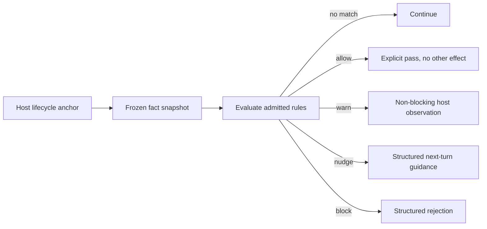

# Open Agent Rules

Open Agent Rules (OAR) is the typed observation-and-effect layer used for agent guidance and policy. Rules evaluate host facts at named lifecycle anchors and request a bounded host effect:

```text
typed host observation + declarative condition -> host effect channel
```

A rule does not execute code, parse transcript prose, grant capability, or mutate workflow state directly.

**See also:** [Agent tool feedback](agent-tool-feedback.md) · [Guidance conditions](guidance-conditions.md) · [Grounding](grounding.md) · [Agent contract](agent-contract.md) · [Authorization](authorization.md) · [Extend](extend.md)

**Machine truth:** [`schemas/oar/`](../schemas/oar) (vendored rule, selector, and anchor profile map schemas, the vocabulary, and the conformance corpus) · `lycaon/internal/oar/`, `oarcore/`, `oarcopy/` · pack `policy/` units under [`lycaon/config/packs/painted-wolf/`](../lycaon/config/packs/painted-wolf) · [engine declaration](../lycaon/config/packs/painted-wolf/platform/host/anchors/oar-profile.yaml) · [anchor catalog](../lycaon/config/packs/painted-wolf/platform/host/anchors/catalog.yaml) and `host/bindings/` · spec: <https://openagentrules.org/spec/1.0/>

Painted Wolf Code implements Open Agent Rules 1.0 in full: document loading,
the closed typed fact environment, evaluation, copy rendering, hints, and the
conformance corpus. Every copy member is optional. The host may present a
code-only outcome; it must not turn omitted copy into an invented remedy.
Host-specific knowledge facts distinguish unreported observations from measured
zero without changing the standard fact defaults.

## Conformance claim

This engine implements the core tier and all three standard profiles,
`filesystem`, `content-safety`, and `mcp`, and passes every fixture in the
vendored corpus.
`internal/oarcore` is the standard's engine: closed document model, condition
checker and evaluator, copy grammar, selector matching, and the fact
environment. `internal/oar` binds it to the host: fact providers, anchors,
counters, detectors, and delivery.

The [engine declaration](../lycaon/config/packs/painted-wolf/platform/host/anchors/oar-profile.yaml)
carries the published anchor profile map (`profile_map`, validated against
`oar-profile.schema.json`) together with everything the engine declares before a
rule compiles: the profiles it claims, its host anchors, every `paintedwolf.*`
host fact with its type, the detectors it resolves, and its limits.

## Why rules are separate from host code

Policies such as when to nudge an agent to ground a claim, block an unsafe completion claim, or warn on a suspicious observation need to evolve as declarative content. Putting each case in control-flow code would mix facts, wording, timing, and enforcement. OAR separates them: host code observes and freezes facts; an anchor defines when evaluation is meaningful; a rule composes typed predicates; an effect maps to one host channel; a binding or template explains the result. The host stays authoritative because it supplies the facts and implements every effect.

## Runtime line



Evaluation is deterministic over an admitted rule set and frozen fact snapshot. Selected rules request typed observations lazily; provider failures follow the rule's `on_error` policy. Model classification is not part of condition evaluation.

## Rule kinds

A rule's `kind` is one of `schema`, `policy`, `invariant`, `detector`; `hint` marks a document that is never evaluated ([Hints](#hints)). For rules, kind fixes evaluation order and nothing else: evaluation runs schema, then policy, then invariant, then detector. Kind says *when among its peers* a rule is checked, not why it exists or what it may do.

| Kind | Evaluates | Typical use |
|---|---|---|
| `schema` | first | shape and argument validation before policy reasons about input |
| `policy` | second | ordinary conditional rules — the bulk of pack content |
| `invariant` | third | host-level guarantees that must hold regardless of policy outcome |
| `detector` | last | project an observation (via a registered `detector://` reference) for later rules or provenance, never a verdict |

An engine must not derive a threshold, weight, or decision from `kind`; that belongs in `when` and `effect`. Kind and effect are independent axes.

## Rule document

A rule identifies itself, selects one or more anchors, declares a typed condition, and names an effect with structured parameters. Human title and rationale explain the decision; stable ids and codes carry identity.

Rule identity is the document's `namespace` and `id`, independent of filenames and package names. The documents loaded together form one rule set: duplicate identities across contributing packs are load errors, and an `on_error` substitute or a counter read names a rule of the same namespace that the set contains. Configuration cannot disable or downgrade a rule whose `mandatory` is true, and a mandatory rule cannot be monitored ([OAR-OPS-5], [OAR-OPS-9]). Structured rejection codes are agent-public: a retired meaning is never reused, and deprecation names its successor.

Unknown behavioral fields, facts, values, effects, or parameters fail validation. A rule names every non-core fact it reads, in `when` or copy, in `requires_facts`; a fact this host does not provide fails the load with its name.

Copy members (`what`, `cause`, `why`, `fix`, `instead`, `message`) are top-level fields that bind facts through the Appendix B grammar: `{{ fact }}` and `……`. Host metadata such as the provenance channel and category lives in `x-paintedwolf-` fields and never affects a decision.

### Host extensions

Host behaviour the standard leaves to the implementation is carried in `x-paintedwolf-` fields, which other engines ignore:

| Field | Meaning |
|---|---|
| `x-paintedwolf-emit` | Provenance channel (`guard:…`, `rule:…`, `banner`) |
| `x-paintedwolf-category` | Rejection category, part of the code's agent-public meaning |
| `x-paintedwolf-scenarios` | Copy renders that authoring checks |
| `x-paintedwolf-evidence` / `x-paintedwolf-context-schema` | Evidence notes and the template keys a copy-only unit requires |
| `x-paintedwolf-audience` | Tool profiles that may receive the rule |
| `x-paintedwolf-status` / `x-paintedwolf-successor` | Deprecation and the code or boundary that replaces it |

### Hints

A `kind: hint` document carries static copy for a code the host raises itself and is never selected or evaluated ([OAR-HINT-1]). A deprecated code whose rule no longer decides remains a hint so its meaning stays known.

## Anchors and bindings

An anchor names a host lifecycle observation: tool pre-invoke, tool post-invoke, coordinator turn closeout, phase exit, worker finalize, authorization decision. Anchors are the timing source for both guards and informational prompt injection: host code emits one anchor with typed facts, and bindings select templates for matched informational effects, so a policy check and its explanation cannot drift onto different moments.

The specification fixes eight core anchor ids; the anchor profile map binds each to a local catalog anchor ([`engine_declaration.go`](../lycaon/internal/oar/engine_declaration.go)). A rule's `on` names a core or host anchor. Rules authored against core anchors are the portable subset.

A selector has one clause, `tools`, which admits occurrences of the named tools; `{}` admits every occurrence. Everything else a rule scopes on is a fact its condition tests: `paintedwolf.session_posture == "spec"`, `paintedwolf.session_role == "worker"`, or `paintedwolf.operation == "find"` for the native operation beneath `command`.

| Catalog anchor | Runs | Notes |
|---|---|---|
| `tool.pre_invoke` | before a tool call is dispatched | core; scope with `selector.tools` |
| `session.pre_invoke` | before a prompt-loop tool call, with session posture, tool identity, and arguments observable | precedes coordinator-specific observations and the executor's core tool boundaries |
| `tool.handler` | after shared argument validation, before dispatch to the tool implementation | core |
| `tool.rejected` | when an intrinsic typed tool failure is raised, before its feedback is delivered | does not replay pre-invocation rules or undo effects of a completed call; publishes `paintedwolf.rejection_code` |
| `tool.post_invoke` | on the complete result, successful or failed, before logging and delivery | core; a block withholds the original result and clears parallel captures |
| `credential.assignment` | on one literal credential assignment observed on a completed tool call | measurements, harvest membership, device HMAC fingerprint |
| `coordinator.post_turn` | on the assembled final prose once, before turn completion | implements core `agent.post_turn` |
| `coordinator.mid_turn_note` | when a coordinator's text beside tool calls is withheld from the user | informs through the shared host feedback path; the tools in that response still run, and only an unresolved reference spends grounding friction |
| `coordinator.closeout_check` | on a provisional closeout claim | a block requests repair; provisional checks cannot multiply a portable rule's counters |
| `worker.finalize` | on the complete parent envelope before the worker card or digest is stored | implements core `agent.finalize`; a block delivers policy feedback with a partial status and withholds the report, proof, and grounding details |
| `worker.report_check` | on a provisional worker report | can request repair before final delivery; not the portable finalization boundary |
| `content.input` / `content.output` / `content.tool_result` | content-safety boundaries | core `model.input` / `model.output` / `model.tool_result` |

Model response prose is buffered until `content.output` resolves. The shared response classifier supplies non-executable text-action observations at this same boundary; `TOOL_ACTION_IN_TEXT` uses the existing bounded rejected-draft repair lifecycle for coordinators and workers. Live progress contains metadata; the final policy result controls transcript persistence, replay, and returned prose.

A non-blocking decision queues the engine's frozen copy and structured identity; it does not require the rule to exist in the stock presentation registry.

Rules may subscribe only to anchors whose fact environment satisfies their condition. The validator catches impossible references before the pack becomes effective.

## Fact discipline

Facts describe observations, not conclusions the rule wishes were true. Good facts: the tool name and structured arguments the host admitted; whether the executor applied confinement; active workflow phase and open gate ids; evidence receipt counts and types; worker state from the coordination ledger; provider readiness from the model catalog; a structured MCP error code from an admitted binding. Bad facts: “the user probably wants deployment” inferred from chat; “the change is safe” because no keyword matched; “the agent researched enough” because it said so; “the destination was observed” when it was only declared.

Facts use neutral polarity. Prefer `verification_receipt_count = 0` over `agent_failed_to_verify = true`. The rule defines the policy interpretation and can combine the observation with phase, tool availability, and explicit exemptions, so a new policy does not need a new host boolean for every conclusion.

Intrinsic tool failures publish `paintedwolf.rejection_code` at `tool.rejected`; stock denial policies test that identity where a shared `policy_denied` flag would be ambiguous. Diagnostic `reason` and `field` values publish `paintedwolf.arg_validation_reason` and `paintedwolf.arg_validation_field` without replacing canonical tool or MCP identity. `paintedwolf.tool_profile` is the effective tool profile; `paintedwolf.session_role` says whether the occurrence belongs to a coordinator or a worker. `paintedwolf.principal` is the authenticated person, falling back to the stored session owner, and `paintedwolf.principal_roles` comes from the authenticated caller. Worker finalization resolves stored session facts only when a rule references them.

## Fact catalogue

The release gate checks fact signatures and retirement successors against the
published stable baseline. The structured retirement catalog is
[`agent-public-retirements.json`](../schemas/agent-public-retirements.json).

`paintedwolf.high_risk_tool` is deprecated and retired because its provider combined policy categories, contrary to OAR-FACT-7. Its named successor is the explicit rule expression `(paintedwolf.tool_is_state || paintedwolf.tool_is_delegation || paintedwolf.tool_is_handoff || paintedwolf.tool_is_task)`. The fact environment no longer declares the retired name; a rule naming it fails load with the undeclared identifier before evaluation. This is the published retirement rule for that agent-public fact; the name must never be reused. The independent host posture-condition vocabulary retains its existing authorization behavior.

`paintedwolf.relocated_field` and `paintedwolf.nested_under` are retired. Their successors are the explicit field list `paintedwolf.misplaced_fields` and the structural locations `paintedwolf.found_under` and `paintedwolf.belongs_under`. `paintedwolf.unparsed_json` is retired; use `paintedwolf.json_encoded` for a JSON string where a structured value belongs and `paintedwolf.json_malformed` for invalid JSON syntax. The retired identifiers are no longer advertised, fail rule loading, and must never be reused.


Internal occurrence facts are grouped into typed domains for invocation, session, progress, workflow, workers, execution, refusals, source, access, content, grounding, MCP, and counters. These Go domains are not standard profiles. The activation projection uses the declared flat fact names and types; lazy provider state and the pre-occurrence counter snapshot keep their own lifetimes ([OAR-FIRE-5]).

The fact environment is closed and declared before any rule compiles ([OAR-FACT-1]), in three tiers ([`catalogue.go`](../lycaon/internal/oar/catalogue.go)):

| Tier | Names | Provided |
|---|---|---|
| Core | `tool`, `tool_args`, and the counts the engine maintains: `fire_count`, `breaker_count`, `same_code_reject_run`, `same_call_run`; functions `fire_count_of` and `breaker_count_of` | at every anchor |
| Standard | `filesystem` (`is_directory`, `not_found`, `path_outside_scope`), `content-safety` (`prompt_injection_score`, `jailbreak_score`, `pii_entities`, `secret_matches`), and `mcp` (server identity and lists, `mcp_tool_name`, `mcp_call_ok`, `mcp_error_code`, `mcp_result` with `mcp_field_bool` and `mcp_field_int`) | whole, as claimed in the engine declaration |
| Host | `paintedwolf.*` | as declared in the engine declaration |

Parameterized observations are typed functions over a declared argument, such as “receipt of this type exists”. A map fact's string members read by dotted reference, so `mcp_result.status` is the `status` member of `mcp_result`. `paintedwolf.tool_arg_string`, `paintedwolf.tool_arg_int`, and `paintedwolf.tool_arg_bool` read one tool argument by name with that type, and return the type's zero value when the argument is absent or holds another type; an integral decoded number counts as an `int`.

Parameterized observations are not arbitrary callbacks. Their names, argument types, cost, and result types are part of the closed environment. Evaluation cannot read the filesystem, network, database, or transcript beyond facts already captured for the anchor. Exact names and operators: [Guidance conditions](guidance-conditions.md).

## Conditions

Conditions compose typed facts with equality, membership, ordering where defined, boolean operators, the string builtins `starts_with`, `ends_with`, and `contains`, and bounded collection/observation functions. Absent observations take their declared typed zero. Unknown names and static type mismatches are load errors. Equality and ordering compare values of one type. Invalid runtime provider values, overflow, division by zero, and a map member that is absent or not a string raise evaluation errors handled as the standard defines.

There are no regular-expression operators, and chat or transcript prose is not a fact. Text matching is allowed only on sanctioned event sources such as detection-pack command fields, outside this core fact floor.

## Effects and channels

`effect` is one of `block`, `warn`, `nudge`, `allow`:

| Effect | Channel |
|---|---|
| Block | return a structured rejection from the transition being guarded |
| Warn | record and surface a non-blocking host observation |
| Nudge | queue structured user-role guidance for the next coordinator turn |
| Allow | record an explicit pass; contributes no decision and cannot override another rule's block, warn, or nudge |

Across the shipped `painted-wolf` packs only `block`, `warn`, and `nudge` are in use; `allow` is a valid effect no shipped rule uses.

Evaluation runs in `kind`, then `id`, then `namespace` order. The first enforced rule firing with `block` short-circuits the occurrence ([OAR-EVAL-3]). Otherwise a nudge outranks a warn, and within the winning effect the first firing rule decides ([OAR-EVAL-10]); the other firing rules appear only on the applied-rules trace. Composition falls out of that order: a specific refusal sorted ahead of a general one wins without any rule naming another.

There is no `ask` effect. Nothing wires an OAR effect into the human-approval/checkpoint subsystem (`internal/approvals`, `internal/authzcontext`); a rule that wants a human decision expresses it as `block` with a remedy the human can act on, or `nudge`.

`inform` is a **binding**-side effect, not a rule one. The shared Anchor Binding grammar ([`anchor-binding.schema.json`](../schemas/anchor-binding.schema.json)) has two bus classes, `inform` and `block`; `warn`, `nudge`, and `allow` are refinements of the block class. The bundled inform bindings under `platform/host/bindings/` declare `effect: inform` with a `render:` template stem; that is the [anchors-and-bindings](#anchors-and-bindings) path for informational prompt injection. No rule document may say `inform`.

Rule kind does not restrict effect. Rules never rewrite content: a content anchor either delivers what it observed or blocks it. Rule parameters can narrow copy and scope but cannot select arbitrary code or bypass the effect operation.

Each occurrence delivers one decision with one stable code. The applied-rules trace keeps every rule's outcome for diagnostics and audit.

## Stateful effects

Rules are pure. The engine or responsible subsystem stores counters, deduplication, leases, retry ceilings, and “already shown” state.

Each occurrence reads a snapshot of rule counters, keyed by rule identity and session ([OAR-FIRE-4], [OAR-FIRE-5]). Firing enforce rules request increments or resets through `on_fire`: `increment_counter` writes `fire_count`, `increment_breaker` writes `breaker_count`, and another rule of the same namespace reads them through `fire_count_of("ID")` and `breaker_count_of("ID")`. Monitored, nonmatching, and errored rules apply no side-effects, and an event the host stream refuses changes nothing else ([OAR-FIRE-7]).

The engine also maintains two runs per session and anchor ([OAR-FIRE-8], [OAR-FIRE-9]): `same_code_reject_run` counts the trailing occurrences blocked with one code, and `same_call_run` the trailing occurrences that repeated the current tool and arguments exactly. Neither a host provider nor a fixture may supply them ([OAR-FIRE-10]). Host retry observations, such as the loop guard's `paintedwolf.repeat_count`, are separate host facts.

`WEAK_CREDENTIAL_LITERAL` and `CREDENTIAL_LITERAL` own the credential advisory thresholds. Each tests `paintedwolf.credential_occurrences == 0`, the session's earlier sightings of the candidate's fingerprint, so it warns once per credential per session. Harvest membership is checked against the root session. The host carries no separate warning latch.

## MCP facts (generic)

MCP payloads vary by provider, so device-only bindings project registered call/result fields into a small generic fact set: provider and tool identity, call success, declared structured error code, bounded subject or category, resource identity from a typed field, and readiness of a named MCP requirement.

Bindings read fields, not prose. An error code must come from the declared error structure; success comes from the protocol result. The binding schema validates paths and value vocabularies before admission. These facts support policy composition without embedding provider payload schemas in the rule engine; they do not make the tool available, grant it permission, or claim an external effect the host did not observe.

## Content-safety surface

Inbound content safety uses explicit authority and provenance facts. A rule may observe that content came from a tool, repository, attachment, or remote response and ask for the host's bounded handling effect. It cannot scan the content to decide whether it “looks like instructions.”

At content anchors the host publishes one entry per content segment, in segment order: `paintedwolf.content_roles`, `paintedwolf.content_origins`, `paintedwolf.content_authorities`, `paintedwolf.content_trust_tiers`, and `paintedwolf.content_sources`. `paintedwolf.content_segment_count` counts the segments, `paintedwolf.content_contains_untrusted` is true when any segment's trust tier is `untrusted`, and `paintedwolf.content_length` is the length of the content.

Outbound secret protection uses host secret evidence and typed redaction/exfiltration facts. Detector rules can add provenance such as credential minting, but the security subsystem performs screening and approval.

## Pack composition

OAR documents are extension units. Inventory derives identity from each document's namespace and id. Before resolved selection can hide a document, duplicate identities and mandatory disabling are rejected. The production loader validates every admitted document against the declared fact environment and links cross-pack references. The immutable rule set is bound to the contribution frame revision.

Project policy is repository-controlled capability content. Once its exact content is approved, enabled tighten-only policy applies within the allowed project effect ceiling. It cannot define new facts, anchors, effects, or device authority, and an edit invalidates the approved stamp before the new rules can apply.

## Authoring

1. Identify the host transition responsible for the desired behavior.
2. Choose an existing anchor whose frozen facts prove the condition.
3. Express observations neutrally and compose the policy in `when`.
4. Choose the narrowest legal effect and stable code.
5. Put explanatory sentences in catalog templates, not Go.
6. Add positive, negative, and near-miss fixtures, and copy scenarios for each rendering state.
7. Run rule validation and render the matched guidance.

If the required observation does not exist, add one host fact at the enforcement boundary. Do not approximate it with a keyword, filename, command name, or model claim.

## Conformance

The vendored corpus lives in [`schemas/oar/conformance/`](../schemas/oar/conformance) and runs through the production loader and evaluator ([`corpus.go`](../lycaon/internal/oar/corpus.go), [`cmd/oar-conformance`](../lycaon/cmd/oar-conformance)). A fixture carries `rule` (one document or a list), optional `hints`, and an `input` with `anchor`, `facts`, `recent_tools`, `session_id`, `host_facts`, `profile`, and `occurrences`, the earlier occurrences of the same session that run first; `expected` asserts any of `decision`, `code`, `on_fire`, `applied`, `counters`, `copy`, and `error` about the last occurrence, and any other key is refused. Each fixture runs on an engine whose anchor profile map is the fixture's own or maps every core anchor to itself, claims every standard profile, and provides the three reserved detectors.

Pack fixtures use the same shape and run through `pw rules test`; the [portable pack](../lycaon/config/oar-portable-pack) carries the standard's example rules and fixtures.

## Invariants

- Rules observe host facts and request bounded effects.
- Conditions are pure; observation providers and declared side effects have explicit error handling.
- Prose is rendered from catalogs and never parsed back into policy.
- State belongs to the engine or domain subsystem, not the rule.
- MCP bindings project typed fields and grant nothing.
- Project rules cannot widen device authority.
- Stable codes and ids carry meaning; display copy does not.
