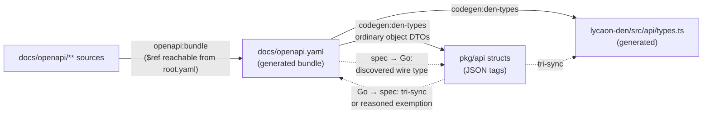

# Test strategy

How Painted Wolf Code proves v1 behavior.

**See also:** [Dev tasks](dev-tasks.md) · [Architecture](architecture.md) · [Docs map](README.md)

---

## Layers

| Layer | Location | Covers |
|-------|----------|------|
| Unit and component | `lycaon/internal/<pkg>/*_test.go` | Parsers, registries, evaluators, merge rules, and domain logic |
| Integration | `*_integration_test.go` (the `integration` build tag), `lycaon/test/wiring/` | SQLite, assembled managers, and the real application graph |
| Contract | `lycaon/test/contract/<domain>/` | OpenAPI, generated artifacts, catalog invariants, package boundaries, and forbidden shapes |
| HTTP journey | `lycaon/test/security/` | Authenticated routes, project policy, sessions, workflows, tools, and recovery |
| Den | `lycaon-den/src/**/*.test.*` | Stores, components, projections, accessibility, and client behavior |
| Browser and desktop | `lycaon-den/e2e/` | Complete user journeys through the web harness and Tauri shell |
| Performance | `cmd/lycaon-perf`, Go benchmarks | Release-channel boot and mixed workloads, latency distributions, resource stability, restart/replay recovery, and focused hot paths |
| Release | release workflow targets | Full Go behavior, race detection, scanner corpora, and Go and Den coverage floors |
| Reference userlands | `lycaon/test/referenceuserland/` | Pinned GNU, BSD and busybox container images and the runner command conformance compares with ([Reference userlands](#reference-userlands)) |
| Command conformance | `lycaon/test/commandconformance/`, `lycaon/test/wiring/conformance/` | Shell programs run through the `command` entry and compared with the reference userlands' results ([Command conformance](#command-conformance)) |
| Verification runner | `scripts/verification_tests/` (`scheduler`, `ci`, `distribution`, `evidence`) | The `./task` queue: planning, batching, admission, cancellation, caching, reuse, health, and worker limits, through bounded subprocess fixtures |
| Coordinator benchmark | `scripts/coordinator-benchmark/` | Opt-in paid runs of candidate models through the real application, graded on environment outcomes — [Coordinator benchmark](coordinator-benchmark.md) |

The bundled OpenAPI document is generated from `docs/openapi/**`. Contract tests prove its layout and its agreement with generated Go and TypeScript surfaces, in both directions and at both ends of the pipeline:

- **Go → spec.** Every exported `pkg/api` struct with JSON tags either tri-syncs against an OpenAPI schema and a generated `types.ts` schema, or claims a reasoned exemption in `structGoInternal` (never on the wire) or `structOneOfCarrier` (flat carrier for a `oneOf` schema). Structs with no JSON tags and structs that embed a field are accounted for the same way, because both would otherwise escape the field comparison.
- **Spec → Go.** Every OpenAPI object schema has an automatically discovered Go wire type or an explicit custom-representation exemption. Ordinary object DTOs are generated from the schema; no second type registry is maintained.
- **Spec source → bundle.** Every definition under `docs/openapi/**` is reachable by `$ref` from `root.yaml`. Unreferenced spec source never enters `docs/openapi.yaml`, so bundle drift, `codegen:den-types`, and the struct tri-sync are all blind to it.

Solid arrows generate; dotted arrows are contract-test proofs:

Database architecture tests derive their scope from the live schema: they
discover authored tables and foreign keys through SQLite, ask the query planner
whether lifetime-parent lookups are indexed, and enforce strict keyed storage,
so new tables and larger histories enter the same proof automatically.
Behavioral stores use differential models where practical: the SQL and memory
implementations must produce the same seek pages, and concurrency tests close
and reopen the store before running integrity checks. The SQLite concurrency
suite holds a reader snapshot open while direct writes, immediate write
transactions, and passive checkpoints overlap, proving that writes serialize
without `BUSY_SNAPSHOT`, checkpoints report pinned frames without rejecting
writes, every reader is read-only, and orderly shutdown drains readers before
truncating the WAL.

## OAR and catalog verification

`./task oar:verify` runs `test:oar` (engine, declared facts, copy rendering,
tool vocabulary, full catalog construction, and rejection delivery) without
`-short`, so catalog-wide walks that `test:short` skips still run, then the
vendored standard corpus through `oar:conformance`. The full `check` gate
includes it. `oar:conformance --json` is the machine-readable standard report
for comparison with other implementations.

Catalog scenarios must reach their intrinsic rejection through the OAR evaluator
before any fallback renderer runs. Recovery vocabulary checks include backticked
call examples as well as bare tool names. Tests of changing anchors prove that the
recipient audience is recomputed. Invocation recovery facts are lazy and use the
frozen offered-tool list; another profile's tools and later request state cannot
widen the recommendation. These checks prove wiring, declarations, and
observable behavior; they do not freeze prompt wording.

## Test rules

- Tests make no real LLM calls. Use fixtures, stub providers, fake MCP servers, and `LYCAON_LLM_MOCK=1`. Live provider smoke tests require the `live_llm` build tag in addition to credentials; they never run in normal, full, race, or coverage suites and still require separate authorization for paid calls.
- Invalid manifests, unknown vocabulary ids, and forbidden ids fail at load or transition time.
- New HTTP routes carry a contract test and an authenticated HTTP journey.
- Durable encoding tests compare exact bytes, BOM state, line endings, and raw hashes.
- Go failures use `testutil.FailErr(t, "<step>", err)` or `check.FailErr` from the contract suites' shared `internal/check` package.
- No test asserts on markdown prose. A `docs/**.md` page is written for a reader, so a test that parses one turns an editorial choice into a build break. `docs/openapi/**` is different: that tree is the hand-edited wire SSOT, and checking it against generated Go and TypeScript is a spec contract.
- Race failures are product failures. Fix the synchronization boundary; do not skip, retry, or sleep around them.
- Each E2E tier starts and stops its own dependencies.
- Fixture corpora are committed. A test keyed to a path outside the repository runs on one machine and skips on every other.
- A suite that needs a provisioned host — applied Seatbelt, a staged scanner engine — derives its gated inventory from source and fails when the declared CI scope does not reach a member. Where a job promises the suite, its `*_REQUIRED` flag makes a missing dependency fatal instead of a skip.
  Applied Seatbelt recipes live in `scripts/verification-plan.json`: the complete confinement package, the exact packages owning gated consumers with their integration build tag, and the scanner stress suite. The existing source-derived inventory checks these declarations. Each stage enters through `./task test:seatbelt` and retains its own captured-source evidence.
- A test belongs in the cheapest layer that can prove its promise. Unit/component tests exercise one domain boundary with in-process collaborators; repository contracts prove a durable cross-tree invariant; wiring tests prove assembled managers; HTTP and browser tiers prove a user-visible journey. Do not use a repository scan to stand in for behavior, or an end-to-end journey to prove a parser branch.
- `test:short` is only the unit/component feedback loop. Repository contracts run beside it as their own `test:contract` stage of `check-fast`, because they are cheap and are the boundary changes most often cross. External integration, wiring, process smoke tests, and HTTP journeys remain mandatory but run as named closeout/release tiers, where their failure names the boundary rather than making every edit wait on a source-tree crawl.
- Files classified as internal integration carry the `integration` build tag and stay out of `test:short`; `test:integration`, `test:full`, and `test:race` opt in explicitly and run without `-short`. Source-content limit journeys, document compaction/reload scenarios, full checkpoint-cap capture, and archive entry-limit extraction assemble real stores and filesystems, so they belong to this tier with their exact limit and editing-history fixtures intact. Randomized SQLite lifecycle properties in `test/property` use the same tag; pure in-memory properties remain in the normal suite.
- Keep scale sweeps separate from boundary proofs. Routine source-tree tests exercise first and late pages and indexed edits at 1,000 and 4,096 rows; stress runs repeat the same assertions at 100,000, one million, and ten million rows. Do not shrink a fixture below a real page, spill, or byte-limit boundary merely to save time.
  Scanner output and contention checks use a declared Swift finding corpus: dense output returns 2,400 findings and exceeds the console capture size, while contention proves simultaneous engine work. These fixtures enforce host RSS of 256 MiB, aggregate RSS of 256 MiB plus 768 MiB per scan, and a 32 MiB dense-output budget. They do not impose a product report-size limit. Cancellation and shutdown retain their sustained mixed-language workloads.
- A test must invoke the production transition it claims to prove. Test-local copies of draft settlement or retention deletion are not lifecycle coverage.
- Use virtual clocks for in-process timers (`testing/synctest` in Go and Vitest fake timers in Den). Mutex-contention tests need real bounded deadlines: a mutex wait prevents Go virtual time from advancing. Synchronize queue tests on admission and completion; use a required barrier when the queue deliberately drops writes.
- Den follows the same cadence: `den:test:fast` proves a representative model-and-DOM seam canary, while exhaustive model tests, component fixtures, accessibility checks, and repository scans run in full `den:test`. Browser journeys remain their own explicit tier.

## Shared test infrastructure

Repository-wide source assertions use a corpus snapshot instead of opening and
parsing the tree independently in every test. The dependency-free Go API is
`lycaon/pkg/testcorpus`: deterministic file selection, relative lookup and
subtree views, cached snapshots, Go AST parsing with a shared token file set,
and an explicit non-empty assertion. Contract tests share cached loaders in
`lycaon/test/contract/internal/check/source_corpus.go` and `go_ast_corpus.go`;
Den source contracts use the matching snapshot API in
`lycaon-den/src/test/source-corpus.ts`.

Use the narrow fixture at the boundary being exercised:

| Need | Fixture |
|------|---------|
| Disposable prepared SQLite store | `internal/testdbfixture` |
| Temporary Git repository and commits | `internal/testutil/gittest` |
| Go module or checkout root | `configlayout.FindModuleRoot` or `testutil.CheckoutRoot` |
| Process-wide Anchor, guidance, Git, or browser setup | the corresponding `internal/testsetup/*` package, called explicitly from `TestMain` |
| Partial Den API client | `lycaon-den/src/test/client-fixture.ts`; undeclared method access fails immediately |
| E2E connection, workflow, project-file, or session synchronization | `lycaon-den/e2e/helpers.ts` |
| Rust temporary directory lifecycle | `lycaon-den/src-tauri/src/test_support.rs` |

The shared fixtures centralize lifecycle and failure labeling without hiding the
state relevant to a scenario. Tests of database recovery, backup, Git plumbing,
or filesystem traversal may still use the underlying mechanism directly when
that mechanism is the subject of the test.

### Contract organization

Contract suites live in domain packages under `lycaon/test/contract/`:
`agentcontext`, `architecture`, `catalogs`, `evidence`, `files`, `frontend`,
`host`, `hosted`, `maintainability`, `persistence`, `prompts`, `providers`, `release`,
`runner`, `scanning`, `security`, `sessions`, `tools`, `wire`, and `workflows`.
The root package keeps the source-snapshot tests. The `test:contract` target
discovers the complete subtree. Shared support lives under `internal/`: `check`
(failure labels, repository root, source and Go AST corpora), `wirespec` (OpenAPI
and client parsing), and the `catalogfixture`, `toolfixture`, `workflowfixture`,
and `guidancescan` fixtures. Keep a scanner with the contract it proves and use
shared support for cross-domain mechanics. Source assertions follow subpackages
and import manifests, so a split file never leaves them inspecting an empty entry.

## Reference userlands

Command conformance compares the command language with real userlands rather
than with expectations written by hand. `lycaon/test/referenceuserland` defines
three Linux container images and the one runner every consumer uses:

| Userland | Contents | Shell |
|----------|----------|-------|
| `gnu` | Debian 13 slim with GNU coreutils, sed, grep, findutils, gawk, tar, gzip, diffutils, patch and procps, util-linux's `column`, `hexdump` and `rev`, and the shared tools | bash |
| `bsd` | The same Debian base and archive snapshot with the GNU packages that FreeBSD replaces removed, and chimerautils (FreeBSD 15.1's utilities ported to Linux) installed in their place, including FreeBSD awk, sed, grep, find, xargs, diff, patch, gzip and `/bin/sh`; `tar` is libarchive's bsdtar | bash |
| `busybox` | The upstream busybox image (musl build) and nothing else | busybox sh |

The shared tools (bash, jq, yq, git, ripgrep, file, curl, xxd, zip, unzip,
bzip2, xz, perl's `shasum` and lsof) are the same builds in `gnu` and `bsd`, so
a difference between those two comes from the BSD utilities. A command FreeBSD
lacks, such as `tac`, is not found in `bsd`, as on FreeBSD.

**Pinned and reproduced.** `userlands.json` pins each base image by digest,
each package to an exact version from one Debian archive snapshot (with the
versions the archive rebuilt for one architecture), and each source archive by
SHA-256; the Containerfiles take nothing else and build without a context. Each
userland also records, per architecture, the digest of its image's file tree:
every path, type, permission, owner and content, apart from the files a
container runtime provides. `./task userlands:build` builds the missing images
and tags one only when its tree matches the recorded digest, so a tagged image
is the reproduced one. After changing a pin, `./task userlands:record` rebuilds
without any cache and records the new digest; record each architecture on a
native host, because emulated builds are not dependable.

The images are built from their pins and cached for CI; they are not distributed.

**One fixed environment.** A batch of programs runs in one new container with
no network. Before each program the driver resets the workspace, home and
temporary directories, seeds the workspace with fixed times and owner, and runs
the program as an unprivileged user with a fixed environment, the same in every
userland; when the shell exits, whatever it left running is killed. The package
documentation lists the environment. A result carries the status, both output
streams as exact bytes, and the final state of each tracked path.

**BSD coverage.** chimerautils ports FreeBSD's own sources, so options, error
text and statuses are FreeBSD's. What it cannot carry over:

- Regular expressions, `printf` and `strftime` formatting, and locale data come
  from glibc, not FreeBSD's libc. For example, glibc accepts `\+`, `\?` and `\|`
  in basic regular expressions.
- FreeBSD's process tools (`ps`, `pgrep`, `pkill`), `bc` and `dc` are not
  ported, so `bsd` has none of them.
- FreeBSD features without a Linux counterpart are removed, such as `chmod -h`,
  file flags and NFSv4 ACLs.
- macOS ships its own, older FreeBSD-derived tools with Apple changes. A
  spelling only macOS implements, such as `base64 -D` or `-b`, is covered by
  golden tests rather than by this userland.

`./task test:userlands` verifies the images and runs the runner's contract in
all three: the fixed environment, the identity of each userland's tools, exact
result bytes, isolation between programs, and repeatable results. The ordinary
suites never need Docker; they compare with stored snapshots.

### Command conformance

The conformance corpus (`lycaon/test/commandconformance`) is a list of shell
programs, each with the workspace it starts from, the paths whose final state
counts, and the userlands it compares with. A case names only the userlands
that implement every spelling it uses: `stat -c` compares with `gnu` and
`busybox`, `stat -f` with `bsd`, and bash syntax or tools busybox lacks with
`gnu` and `bsd`. A spelling no reference implements, such as macOS's
`base64 -b`, is covered by its lane's golden tests instead, and the corpus
names that test.

The command entry passes a case when its status, both output streams and every
tracked file (content and permissions) equal one of the case's userlands. Only
these deliberate differences are normalized:

- The command language always has `pipefail` and, in bash, `globstar`; each
  reference program starts with a prelude that enables them.
- The command entry runs in a real project directory, whose absolute path
  stands for the reference workspace, `/workspace`.
- The command entry writes a shell error as `bash: …`, without the line number
  a shell running `-c` adds.

One deliberate difference is checked exactly rather than normalized: under the
language's pipefail, a producer ended by SIGPIPE because its reader finished
does not fail the pipeline, so `seq 1 100000000 | head -3` exits 0 where bash
exits 141, while `PIPESTATUS` still reports 141. The contract case
`pipefail-reader-ends-producer` holds those expectations.

Host decisions, approvals, labels and receipts are structured results outside
the output streams. A differential case must finish with no refusal and no
fallback to an installed program, so none of them is compared. Programs whose
result the command language defines itself, such as native built-ins, `external`,
`native_path` and redirects that publish over their own input, are contract
cases in `lycaon/test/wiring/conformance` with their expected results.

Snapshots record behaviour only, never a tool's `--help`, `--version`, `info`
or manual output; the corpus refuses a program that asks for them.

`./task conformance:capture` runs the corpus in the verified images and stores
every result in `testdata/snapshots.json`, with the digest of each case's input
and the images it came from (`-- <case>...` captures only those cases;
`-git-seed` records the Git seed repository again in `gnu`). The suite refuses a
snapshot whose case or images changed, so editing a case means capturing it.
`test:wiring` compares the command entry with the stored snapshots and needs no
Docker. `./task test:conformance:live` runs the corpus in the images again,
fails when any stored snapshot does not reproduce byte for byte, and compares
every program through the command entry with the live results.

## Size budgets and changed coverage

Agents write code and prompt copy fast. These checks shape it through
feedback an agent meets while it works: a warning as something approaches
its limit, then a stop for a change that leaves a touched artifact past it.
`check-fast` and `check` run them, and CI runs them in the ready tier and the merge group's `limits` lane with
the same rules and the same words, so CI says nothing `check-fast` did not.

### Size budgets

`./task budgets` measures two suites:

| Suite | Measures | Policy |
|---|---|---|
| Maintainability (`test/contract/maintainability`) | Code-bearing lines per production and test file; handwritten files per production and test directory; Go struct fields; Go receiver methods and receiver lines summed across files and platform variants, so splitting a file cannot hide concentration; distinct local TypeScript imports per module. Generated and vendored files are classified from generator inventories. | [`maintainability-budgets.yaml`](../lycaon/test/contract/maintainability-budgets.yaml) |
| Prompts (`test/contract/agentcontext`) | UTF-8 bytes of every rendered worker persona, coordinator tripartite fixture, inject, agent template, kick, and instruction unit; the tools each coordinator surface and worker profile sends upfront, limited as two classes; and each turn kind's widest static prompt against the model window | `sizes` and `absolute_maximums` in [`prompt-budgets.yaml`](../lycaon/config/packs/painted-wolf/platform/host/prompt-budgets.yaml) |

Each maintainability category has a review threshold (`warn`) and a hard limit
(`limit`). Warnings permit admission and request architectural review after merge; hard
limits reject new or growing excess. Maintainability measures both the change
base and current source using the same rules. An artifact that must stay
larger can have an explicit cap and reason in its own file under
[`maintainability-exceptions`](../lycaon/test/contract/maintainability-exceptions/).
Prompt limits remain absolute because they protect the model window.

| Standing | Result |
|---|---|
| A touched artifact past its warning line | Warning; creates or updates a post-merge cleanup issue |
| A new or growing artifact past its limit, with no exception | Fails |
| An unchanged or shrinking legacy artifact past its limit | Warning; post-merge cleanup issue |
| Any artifact past its exception cap | Fails |
| A touched artifact within its exception | Notice naming the reason; cleanup issue if above `warn` |
| An untouched artifact past its limit | Counted |
| An exception the change adds or raises | Notice for review |

A change touches a file it edits, a directory it adds files to or removes
files from, and a Go type whose declaration or methods it edits, compared
with the [change base](#the-change-base). Editing a helper beside a large type
does not make the change answer for the type. Prompts are few, so every
prompt past its limit needs an exception, and warnings name the prompts whose
sources a change edited.

#### Maintainability cleanup issues

Cleanup is tracked by source areas rather than one issue for each
metric and artifact. Module workstream issues keep the individual findings and source
evidence together so one architectural review can address related measurements.

[`maintainability-issues.yml`](../.github/workflows/maintainability-issues.yml)
reconciles cleanup issues from the report of a completed nightly observation on
main. The report's source commit must be associated with a PR merged into this
repository's main branch. Only scheduled and manual nightly observations from
this repository are eligible. Successful and failed runs can retain the limits
receipt needed to validate the complete inventory. Failure in another lane does
not hide maintainability debt already merged.

Issues come from the nightly report for artifacts unchanged on main. Main
usually advances while the nightly runs, so each artifact is compared
separately. Its measurement inputs are its measured paths (the file itself, or
the immediate entries of a measured directory or a Go type's package
directory), its review and exception records, and the threshold policy. An
artifact whose inputs are identical at the report source and current main takes
its tracking from the report. A changed artifact is held. The report never
admits it; an open area issue that already lists it keeps it, with the
report's measurement at the linked source commit. An area whose held artifact
would leave or reopen it is not written. The plan's `held` list records each
held artifact's category, ID, report source, and main commit, and
`waiting_intake` lists admissions a hold withheld. A report source that is not
an ancestor of main, and an artifact whose reported sources lie outside its
measured paths, refuse reconciliation.

The maintainability report contains a complete inventory of every artifact above
`warn`, including untouched artifacts and artifacts admitted by an exception.
Each entry records its category, artifact ID, measurement, cleanup threshold,
hard limit, effective exception cap, touch status, source paths, and Go declaration/method spans. Source commit,
tree, change base, and a content digest bind the report to the measured source.
Admission still uses change-scoped findings; a complete tracking inventory does
not turn untouched debt into a gate failure.

Ordinary intake creates issues for artifacts touched by merged changes. The
complete inventory updates existing issues and closes them when they fall to the
cleanup threshold or disappear. This avoids dumping the entire legacy inventory
into GitHub on rollout. A persisted checkpoint and cumulative source diff carry warning intake across
superseded workflow runs, using the measured Go spans to preserve type-level
touch semantics. First intake starts at the parent of the commit that introduced
the tracking workflow, so rapid merges during rollout are covered. Missing commit history stops reconciliation; it never silently treats missing evidence
as completed cleanup.

Artifact identity remains the SHA-256 of `["maintainability", category, artifact_id]`.
Issue identity is the source area path through `internal/`, `src/`, or `test/`,
or a top-level directory for other source. Module sections inside the issue use
the first package under `internal/` or area under `src/`.
Nested packages and metrics share that issue. Grouping derives from paths in the
validated report; it needs no application subsystem list and automatically picks
up new modules. These are cleanup planning areas, not runtime authority boundaries.
Architectural review workstreams remain evidence on their individual findings.

A version 2 machine-owned issue-body block retains every admitted artifact's
identity, measurement in the rendered tables, and thresholds. One area fingerprint
covers all measurements, full source membership, exceptions, structural shapes,
and review records. The compressed, bounded tracking inventory stores admitted identities; it does
not duplicate per-artifact hashes or full measurements.
The linked nightly report
retains the complete evidence. Module summaries distinguish hard-limit breaches
and renewed reviews; expandable sections list individual measurements and source links.
The reconciler preserves human prose outside the block and updates evidence
without comments on each run. Unchanged findings produce no writes. An issue
closes when every admitted finding disappears, drops below threshold, or has a
valid retained review. Invalidated retention renews intake even without a source
touch. Completed area issues reopen when actionable debt returns. Unchanged
not-planned artifact dismissals remain suppressed until touched or changed. An area
dismissal retains its admitted identities and comparison fingerprint. A touch or
any changed evidence renews the area review.

Migration adopts the oldest automatic artifact issue in each area, then closes
other artifact issues as **not planned** with a link to the area issue. The
original evidence and discussion remain accessible; consolidation does not claim
the debt was fixed. An existing area issue takes precedence during replay.
Superseded artifact issues cannot reopen or generate duplicates. Only bot-authored
tracked issues can be adopted or mutated; both marker versions bypass ordinary
issue intake, stale closure, and locking. Human copies are never mutated.

The workflow serializes reconciliation across runs. It reads one bounded current-
attempt limits receipt, validates the entire snapshot and plan before writing,
and compares each area's artifacts with main again before its mutation; an area
with a newly changed artifact is held. A concurrently edited issue stops the run
rather than overwriting the edit. Repeated observations produce no writes. A later
complete snapshot converges a partially applied run. Checkpoints are retained for
90 days; expiration or an unavailable current receipt requires explicit replay/backfill.

To preview or recover, dispatch **Maintainability cleanup** with `run_id` set to
a completed nightly run on main. `dry_run` defaults to
true. `backfill` defaults to false; setting it true includes untouched baseline
debt and establishes a fresh checkpoint after a successful apply. Review the
retained `maintainability-issues.json` plan and category counts before applying a
backfill. Each apply creates at most 25 new area issues, spaces mutations one second
apart, and records applied/deferred counts. Deferred and withheld intake do not
advance the checkpoint; later runs or another explicit backfill dispatch continue it. As details grow, module summaries rank effective-cap breaches and renewed reviews
first. Summary and detail sections have separate byte bounds; overflow links to the
complete report without creating more issues. The 60,000-byte issue bound still fails closed before
any write if even the summary and bounded inventory cannot fit. The workflow never runs downloaded code or changes admission limits.

#### Architectural review decisions

Review records describe a design decision. The commit field records its stated
provenance; fingerprints detect changes to selected source contracts. They do not
prove tests passed. Verification receipts and CI retain that separate role.

A warning measures concentration; it does not prescribe a package boundary.
Review cohesive behavior, runtime dependencies, operation contracts, and state
lifetimes before choosing a refactor. Construction bundles, domain records,
projections, and runtime services have different reasons to grow.

Each JSON record under `lycaon/test/contract/maintainability-reviews/` names one
`category` and `artifact`, a `kind`, a `workstream`, a `disposition`, a `reason`,
and the `reviewed_commit`. Kinds are `runtime_service`, `construction`,
`data_record`, `projection`, `algorithm`, `test_suite`, and `module`. Workstreams
are explicit lowercase identifiers for related implementation work; they do not
change the artifact identity or create new runtime authority boundaries.

A `refactor` decision classifies work without prescribing extraction: simplifying,
consolidating fragments, and moving a genuine boundary are all valid outcomes.
It does not suppress the warning. A `retain` decision requires a numeric `ceiling`
above the warning threshold and at or below the hard limit, plus `boundaries`: a
map of repository-relative files to their SHA-256 digests. Select the contract
tests and declarations that support the rationale. Pin only boundaries whose
changes invalidate the decision; avoid whole implementation files when structural
shape and focused contracts express that boundary.

Retained Go artifacts record `reviewed_shape`, the signature printed in the
tracking report. The checker derives it from the type declaration and method
signatures, including receiver kinds, type parameters, and dependency identity.
Bodies, comments, and declaration order are excluded. Unaliased and dot imports
are conservatively included because import paths need not match package names.
TypeScript dependency reviews record the sorted resolved local module identities
in the same field. Reordering or equivalent import spelling does not renew a
decision; replacing a dependency does. Directory reviews record the sorted
immediate measured source or test members, so same-count membership changes also
renew review while body-only edits do not. A changed structural signature renews
review even when the size stays constant. Review state is measured, never authored.

The checker carries this decision in the source-bound report. Growth beyond the
ceiling or a changed, removed, or nonregular boundary file renews review. Unknown
fields, malformed records, duplicate identities, and records for removed
artifacts fail validation. A rename requires an explicit decision for its new
identity. Decisions never raise hard limits or replace exception caps. Added, revised,
and removed decisions are reported beside code findings so repeated agents can
see policy changes rather than silently ratcheting ceilings. Agents may revise a
decision when new evidence warrants it; record the reason and verify the affected
contracts in the same change.

A retained warning remains in the measured inventory. Its issue closes with an
explicit retained-design status rather than claiming the artifact became small;
renewed review reopens that issue. New retained baseline warnings do not create
issues. The reconciliation report groups reviewed artifacts by workstream and
issue bodies show classification, rationale, reviewed source, current observation,
and the previous observation and delta when evidence advances. Human prose
outside the managed block remains unchanged.

#### Structure declarations and diagnostics

Every directory directly under `lycaon/internal` with ten or more member packages declares its
character in [`structure/declarations.yaml`](../lycaon/test/contract/structure/declarations.yaml):
a `subsystem` promises one concern and names its entry points, a `family` holds alternatives
behind one contract package, and a `container` is an organizational boundary whose members are
governed individually. [`TestDeclaredDirectoriesMatchCheckout`](../lycaon/test/contract/structure/checkout_test.go)
validates declarations against the production import graph and fails when a large directory
stays undeclared, so an accreting boundary must state what it is instead of growing silently.
Entry points and family contracts must name existing production packages inside their declared
directory. A subsystem's explicit access boundary is gated: outside packages may import only
its entry points, including when the private package is nested more deeply. Rejections name the
consumer and private package so an agent can repair the import or review the declared boundary.
Family implementation imports remain allowed for composition; declaring a shared contract does
not impose a new import policy. The graph uses tracked and nonignored regular files, matching
the budget inventory, scoped to `lycaon/cmd`, `lycaon/internal`, and `lycaon/pkg`;
ignored scratch files, deleted files, symlinks, and scanner rule fixtures do not contribute.

The maintainability report carries structural diagnostics for each declared directory as notes:
disconnected member groups, isolated members (no outside consumer imports them alongside a
sibling), and, for subsystems, unused entry points. These are review evidence, not findings:
co-consumption patterns prompt judgment about whether a declared concern is really one, and
never decide it. A subsystem with one public entry point and internal collaborators legitimately
reads as isolated.

#### Prompt budgets

The host assembles a prompt per turn: instruction units render only while
their tools are offered, requestable tool schemas load on demand, and the
decision engine may leave out the units it is confident a request does not
need. The prompt suite measures those parts where they vary. Each instruction
unit has its own limit, because it rides wherever its tools go. Each turn
kind's widest static prompt is then assembled from its own parts: a
coordinator turn from its fixture's system prompt, its surface's upfront
tools, and the injects that can ride a coordinator turn; a worker turn from
its persona, its profile's upfront tools, and the worker injects. Each adds
one request's largest tool loads (`max_loads` in `decisions.yaml`) and the
units they bring. That widest prompt is the one the window check holds,
because every mandatory unit renders when the decision engine abstains or
fails. Every run reports the widest coordinator and worker turns' headroom,
warning below 10%, beside their size once every requestable tool has loaded:
warm turns can accumulate loads until the next cold boundary, so that
figure is context for the runtime rather than a static guarantee. Kicks and project content
(AGENTS.md chains, MCP schemas, source briefs, skill bodies) are sized by
the project at runtime; they ride in the reserved session budget, which
compaction calibrates against the provider's reported token counts.

#### Inspecting sizes

Look before editing something large:
`PW_BUDGETS_INSPECT="lycaon/internal/hitl" ./task budgets` reports those
files and directories as if the change had touched them. When an artifact
fails, split it along a real seam
([Organizing code](architecture.md#organizing-code)) or trim the copy the
failure names. Raise a category limit only when the whole category should
change. The worker persona cap also bounds `pw prompts render --check` and
pack persona validation.

The suites carry the `budgets` build tag, so `test:contract` and `test:full`
do not repeat them. A passing budget does not show cohesion, so review still
reads the structure. Dependency direction is enforced separately by the
[import-graph layering contract](package-layering.md), Go rejects import
cycles at compile time, and `funlen` in `lycaon/.golangci.yml` stays in force.

### Changed coverage

`./task coverage:changes` (Go), `./task den:coverage:changes` (Den), and
`./task scripts:coverage:changes` (Python under `scripts/`) measure the
statements a change adds or modifies. A unit (a Go package, or a Den or Python
file) fails when more than the policy's grace count of its changed statements are
uncovered and fewer than its percentage are covered. Code a change does not
touch never fails it, and floors live in
[`coverage-policy.json`](../scripts/coverage-policy.json).

- **Go** measures each changed package with its own short tests, then measures
  a package that falls short again with the tests of the packages that import
  it, crediting coverage across packages. A test binary records nothing its
  children run, so a test that needs a child counted runs a coverage build of
  it with `GOCOVERDIR` set to `PW_GO_CHILD_COVERDIR`; the run joins those
  counters to the profile and runs tests uncached. A confined child needs a
  write root for that directory. Changed functions in a package no test reaches fail. Packages in `lycaon/coverage-exempt.txt` and generated
  files are skipped, and a touched package below the package floor is noted.
- **Den** runs the Vitest tests related to the changed files and measures
  coverage of those files. Tests, mocks, declarations, and generated files are
  skipped.
- **Python** runs each suite `coverage-policy.json` declares whose tree holds a
  changed script — `test:runner`'s discovery, and the coordinator benchmark's
  own tests for its directory — under the pinned coverage.py. Suites run in a
  disposable virtual environment whose startup hook measures every interpreter
  it launches, so subprocess fixtures count even with a cleared environment or
  `-I`, and a script a fixture copies into a disposable `scripts/` tree is
  credited to its source. Statements are coverage.py's, with no exclusion
  pragmas. Test code (`test_*.py` and the directories the size inventory
  treats as tests, such as `verification_tests/`) is skipped. A child that
  runs a different interpreter is not measured; launch fixtures with
  `sys.executable` or `python3` from `PATH`.

Aggregate floors (`check:coverage`, `den:coverage-check`) read the same policy
and run nightly.

### The change base

Budgets and changed coverage measure against the merge base with the main
branch (`origin/main`, then `main`), so a branch is measured from where it
left; the base decides which lines a change touched, never what size an
artifact may be. `PW_CHANGE_BASE` names a different base. Without a reachable
base, `budgets` reports that nothing was established rather than guessing. Inside a source snapshot the
change includes uncommitted and untracked work. On GitHub Actions every
finding also annotates its file and the job summary.

## Concurrency and type floors

| Floor | Rule |
|---|---|
| Race detector | `./task test:race` is a tag-blocking gate. Fix with synchronisation or single-mutator confinement — never by re-architecting the algorithm to dodge the detector. A concurrent map write is a fatal Go runtime throw, not a stale read |
| Shared-structure discipline | Choose **one** discipline per structure and apply it whole: a mutex around every mutation *and* read, or single-mutator confinement where exactly one goroutine mutates. A half-locked structure reads as safe and is not |
| Test doubles | A double must honour the concurrency contract its real counterpart does. A fake that does not keeps hiding real bugs |
| Bundled-config staging | `configtest.Use` / `Overlay` / `Only` swaps the bundled source for the whole process, so a test that stages config runs sequentially — and every helper that reaches one does too. `t.Parallel()` there panics rather than serving the staged tree to every other test in flight |
| Indexed access | Den compiles under `noUncheckedIndexedAccess`, so `arr[i]` and `record[k]` type as `T \| undefined`. Resolve every access by **narrowing at the access site** — a length or presence check, an early return, a destructure with a default, or widening a helper's return. `!`, `as T`, and `@ts-expect-error` are forbidden as fixes; each hides a gap the compiler just proved. Test files are not exempt |

Every fix in this model is a capacity, a delete, a `select`, a lock, or a type narrowing — never a heuristic ([`AGENTS.md` No heuristics](../AGENTS.md#no-heuristics)).

### Verification scheduling

Local verification shares one queue across checkouts and agents. On macOS and
Linux, admission freezes a batch of at most 32 consecutive compatible requests
from the same checkout and declared execution environment; a different checkout
or environment ends membership, and membership closes before source capture
without a collection delay. Windows retains exclusive admission. Up to eight
batches may be active at once. A gate's stages have no order among themselves:
each starts once its declared resources allow, the longest expected stage
first, and requests in a batch overlap the same way. A batch keeps at most one
stage reservation waiting, so one large gate cannot queue ahead of every other
batch. Invocations outside a batch (non-shareable selections, fixture refreshes,
and targets outside the catalog) hold the union of what their stages declare
for their whole run; only a target nothing declares holds every resource.
Nested commands reuse their operation's reservation.

Admission is first-in, first-out per conflict, ordered by when the request each
piece of work serves arrived. Later work may pass an earlier waiter it conflicts
with only when its estimated completion falls before that waiter could start
anyway. Estimates are the 90th percentile of up to 32 completed runs of the same
name; work without three completed runs, and running work past its estimate,
backfills nothing. A request joins a batch once any of its stages could start,
so several waiters for one lock cannot occupy every active-batch slot. Queued
stage declarations guide admission; the captured catalog owns the locks applied
during execution. Each subscriber returns as soon as its own result is
established.

Shared execution receives only the environment variables the catalog's
`environment` section declares by name or prefix. Agent-session identifiers,
control sockets, and credentials never reach tests or separate otherwise
identical requests. Every declared value must be a function of the checkout
rather than of the call that submitted it: a per-invocation value gives each
request its own digest, which ends batch sharing and result reuse with no
visible failure; `scripts/verification_tests/scheduler/test_environment_identity_execution.py`
asserts that rule against the catalog. Verification is offline: no network route
is declared or passed through, so a stage that dials is denied by the boundary.
Only the environment digest is stored in queue metadata.

The declared plan in `scripts/verification-plan.json` owns gate composition and
shareable stages. Submitted intents are resolved again using the captured
catalog; `resolved-plan.json` records the definitions actually verified. Exact
Task stages run once per batch; compatible Go scopes resolve against its
snapshot and run their package union, longest recorded packages first. A union
adds at most 16 packages to the oldest ready request; larger followers consume
already proven packages and execute the remainder afterward. Within a batch,
package results are reusable with identical execution options; full, short,
race, tags, and filters are not interchangeable.

Across batches, a passing Go package result is reused when nothing it depended
on changed: its build identity (the content of every file compiled or embedded
across the test binary's dependency closure, module versions, tags, race mode,
and the toolchain, independent of the snapshot slot's path), the arguments that
choose tests, the Go runtime settings the binary reads directly, the declared
environment, and every input the Go test log observed (files opened or statted,
compared by content, and environment variables read). Worker counts and timeout
scale are not inputs. A test process that starts another process is never
recorded, because the child's inputs are unobservable; fork observation uses
kernel process events, available on macOS, and elsewhere every package runs.
The per-run scratch home and temporary directories start empty and are not
inputs. Receipts name the batch and stage that recorded a reused result.
Results live under the user cache directory in `paintedwolf/verification-results`,
limited to 2 GiB and 14 days since last use. Selections with explicit repeat
counts run outside batches and never reuse.

Unsupported selection flags reject before admission, as do arguments for a
target that declares no selection grammar and information flags that would run
the target instead of describing it. A declared Go target accepts the digest
package and flag grammar narrowed to its own declared packages, so a scoped
invocation keeps the target's recipe and shares outcomes with the unscoped one.
Supported Go repeat, shuffle, and benchmark modes, fixture refreshes, and replay
run outside a shared batch, holding what their targets declare; so does Go
`-failfast`, whether passed on the command line or through `GOFLAGS`.

Every requester receives its own receipt and exit status. A gate ends at its
first failed or unverified stage, and stages only it still needed stop;
independent requests continue. A Go package failure (a failing test binary exit,
a terminal package event, or a build failure) answers every request that needs
the package while the stage is still running, and the receipt links that
package's output. A package may pass despite an unrelated package failure only
when its terminal Go event and the completed digest establish that result.
Missing evidence and infrastructure interruptions are unverified. A Go stage
whose packages hold test files behind a tier tag it does not enable (a tag some
declared target turns on, such as `integration`) records them per package as
`excluded_tests` and prints how many did not run and which targets run them; its
pass never covers those files. Receipts
identify the source commit/tree and link to the stage logs and reports in
`verification/<batch-id>/` under the
[artifact root](dev-tasks.md#build-outputs-caches-and-locks). Retention keeps
up to 20 completed batches and 512 MiB, pruning artifacts and source refs
together; the newest batch and active batches/subscribers are protected even
when they exceed the budget. No receipt is reused across batches; recorded Go
package results are.

`./task test:status` shows active batches and stages, sharing and queued
requests, global worker capacity, reserved and available slots, each operation's
resource locks and blocking reason with the blocking request's name and ticket,
rendered ages, a one-line summary, and advisory observations (what is holding
the queue, how a run compares with completed runs of the same target, and
whether a batch's captured source still matches its checkout). Reservations are
concurrency limits, not measurements of CPU utilization. `test:pause` holds new
admissions while admitted work finishes; `test:resume` releases the queue.
`test:cancel` withdraws one request by ticket with a recorded reason, keeping
work no other request shares unless it carries an adverse health observation or
the caller forces it. An independent supervisor keeps shared work alive for the
remaining requesters and stops an operation when no requester needs it.
Inherited lease locks prevent an interrupted supervisor's descendants from
overlapping the next admission; canceling that run stops whichever descendants
still hold its lease. Live model benchmarks remain outside the queue; their
build and fixture-test commands acquire admission separately. Interactive
`den:harness` sessions also run outside admission: their sidecar build and
engine staging acquire a separate exclusive reservation through
`den:harness -- --prepare`, which ends before interactive startup. Automated
harness tests and canaries remain queued for their whole execution.

The default worker budget is three quarters of the available CPUs, rounded down
and bounded between one and eight. `PW_TEST_WORKERS` selects a per-invocation
ceiling between one and that budget; shared execution also obeys the global
capacity. The catalog's `resources` declarations reserve half that capacity for
a parallel Go, Rust, or Vitest operation, and one slot for frontend lint or
typechecking, which leaves room for independent work even during a suite's
final serial test. A declaration may request an explicit worker count; an
undeclared operation reserves exclusive access. Go favors package fanout within
that reservation and assigns unused package slots to `GOMAXPROCS` for small
scopes; race runs default to two runtime workers per package. Parallel tests per
package obey the same per-process share; Vitest uses at most four workers.
Fuzzing and Rust builds share the same budget. Runners use the worker limits
assigned at admission; host load only adjusts timeouts, and race runs scale
scheduler-dependent waits at least 3×. Hosted CI sets
`PW_TEST_HOST=dedicated`: one lane owns the runner, so the budget is every CPU
(still at most eight) and a shared operation reserves all of it.

Resource names are global locks: Go digests share `go`, Go lint holds `lint`,
frontend checks hold `frontend`, Cargo tests hold `rust`, and the isolated
scheduler fixtures hold `runner` with one worker. Harness browser tests reserve
half the worker budget and hold `harness` and `frontend`, allowing unrelated Go
work to continue; they run on the captured source with isolated ports and state,
and default browser failure artifacts are retained beside their receipt. Go
package builds declare an empty lock list: their compiler cache supports
concurrent commands, so they reserve CPU slots only. Every catalog stage
declares its resource use; runner tests enforce coverage. Checks that only read
captured source or write private temporary output reserve CPU without global
locks. A resource may declare `shared_locks`: two shared holders can overlap,
but an exclusive holder or earlier exclusive waiter blocks new shared holders.
Go digests capture their reports from private invocation logs before the short
canonical-publication lock, so simultaneous runs cannot substitute another run's
evidence. Bundled-scanner digests additionally hold `scanners` exclusively.
Unclassified stages hold `*`, conflicting with every operation. Targets outside
the catalog declare resources by Task name: the development engine build and
the upgrade corpus runs that depend on it hold `dev-engine` and `scanners`.
Locks and worker reservations are inherited by child processes and remain held
after a parent crash until its surviving children exit. Pause stops new batch
and invocation admission; already admitted batches finish their stages.

Scheduler-dependent waits, watchdogs, and lint timeouts scale 1×–4× with host
load. `PW_TEST_TIMEOUT_SCALE` selects an explicit scale; production deadlines
and polling intervals remain unchanged.

Compilation artifacts use the persistent Go cache across snapshots, tests,
fuzzing, and lint. Snapshot worktrees reuse leased directory slots, preserving
the absolute source paths in Go's compilation cache keys; active descendants
keep their slot, and overlapping snapshots receive separate slots.
Path-sensitive lint diagnostics retain isolated leased caches. Verification
budgets the active Go build cache at 20 GiB, trimming least recently used
entries toward 16 GiB beside running builds; see
[digest captures and locking](dev-tasks.md#digest-captures-and-locking) for the
settings. Go's own test-result cache keys file inputs on modification times,
which every fresh snapshot changes, so full digests pass `-count=1` and shared
stages rely on recorded results instead.

Long gates and digest runs execute from a synthetic commit that captures the
complete tracked and untracked source tree. The capture accepts only two
matching tree ids, then runs from a detached scratch worktree, so concurrent
edits cannot produce a mixed build and generators remain free to publish while
the snapshot runs. Source preparation reserves one worker and a global snapshot
lock, so captures remain serialized across checkouts while other resource
classes can execute. Frontend packages, staged sidecars, and bundled notices are
mounted into the scratch worktree without becoming source inputs. Each capture
refreshes a private copy of the pinned Git engine because harness preparation
reshapes and signs that toolchain.

Routine correctness fixtures cover late pagination and deeply nested session
deletion with bounded row counts. `./task test:stress` runs the 100,000-,
one-million-, and ten-million-row source trees, the 50,000-message session
tree, and a working year of 25,000 real editor saves with retained source
history and three recovery captures. Its catalog recipe keeps packages and tests
serial and allows 90 minutes per package before host-load scaling. The nightly
workflow includes this tier. Active fuzz exploration runs through
`./task test:fuzz` in nightly verification, separately from
`check`; ordinary Go tests still execute saved fuzz seed cases. Transcript
performance tests use the `.perf.test.ts` suffix and run through
`./task den:test:transcript-scale` in nightly verification; normal
Den suites exclude elapsed-time assertions while retaining memory and DOM bounds
as ordinary correctness tests. SQL query and OpenAPI bundle generation drift are
checked once through `db:sqlc:check` and `openapi:bundle:check` in
`check:drift`; Go contracts inspect the generated surfaces without launching the
generators again.

Hosted Go shards partition resolved package identities in both shared admission
and direct captured-source execution. Each direct invocation records its selected
packages in the Actions log, so later runs can verify the actual partition.

The queue coordinator recovers an active merge group whose exact ref and commit
have no CI run by explicitly dispatching the integration profile. The dispatched
plan validates the live queue identity and obtains its comparison base from the
queue before running affected-scope checks. Existing runs, including failures and
cancellations, are never replaced by recovery. Draft events skip the aggregate
check; ready-review events still require successful admission.

## Working commands

Run every task from the repository root through `./task`.

| Task | Use |
|------|-----|
| `./task test:digest -- ./internal/foo/...` | Scoped Go iteration |
| `./task test:contract` | Static and generated contract layer; required by `check` |
| `./task test:integration` | Assembled Go components and randomized SQLite lifecycle properties; included by `test:full` and `test:race` |
| `./task test:security` | Authenticated HTTP journeys |
| `./task test:runner` | Verification runner tests in `scripts/verification_tests/` |
| `./task den:test:digest -- src/path/file.test.ts` | Scoped Den iteration |
| `./task den:test:fast` | Representative Den model and DOM seam canaries |
| `./task den:test` | Full Den Vitest suite |
| `./task e2e:den` | Browser user journeys |
| `./task e2e:den:desktop` | Tauri desktop journeys |
| `./task perf:bench` | Repeated Go microbenchmarks and an optional baseline comparison |
| `./task perf:sidecar` | Representative isolated sidecar workload with enforced latency/resource/correctness budgets |
| `./task perf:soak` | Long mixed workload with graceful restart, task recovery, SSE cursor reset, and leak checks |
| `./task budgets` | Prompt and code size budgets for what the change touches |
| `./task coverage:changes` / `./task den:coverage:changes` / `./task scripts:coverage:changes` | Coverage of the Go, Den, and scripts Python statements a change adds or modifies |
| `./task check-fast` | Local handoff gate: build, lint:full, size budgets, unit/component Go suite, repository contracts, Den typecheck, lint, den:test:fast, changed coverage, notices, comment and failure-message checks, and documentation links |
| `./task check` | Full local and qualification gate: cross-compile, drift, complete Go and scanner suites, full Den and Rust correctness suites, size budgets, changed coverage, lint, and vulnerability checks |

Each gate runs once per change. A pushed change runs affected-scope integration in CI and daily full nightly verification, so it runs neither local gate first; a change handed off without a push runs `./task check-fast`. Each gate uses one stable source snapshot. Digest runners keep failure captures under `last-run/` in the [artifact root](dev-tasks.md#build-outputs-caches-and-locks); `./task test:failed` replays the latest failed Go run from its retained source commit with the recorded arguments and timeouts, bounded by the current worker budget. A passing scoped run does not erase that failure.

Digest output lists up to five slow packages and Go tests, and up to five slow
Vitest assertions, when they take at least one second. Go reports the slowest
event for each top-level test and its subtests, so parallel children remain
visible even when their parent reports zero elapsed time; cached package
timings are omitted. These elapsed times overlap and must not be summed. They
are review signals, not pass/fail budgets; Vitest assertion times exclude
collection and transform cost. Compare captures with the same source and worker
allocation before claiming an end-to-end speedup.

## Release verification

| Task | Proof |
|------|-------|
| `./task test:full` | Complete Go behavior, wiring, smoke, HTTP, and required bundled scanner suites |
| `./task test:race` | Go race detector with integration scenarios and no `-short`; the dedicated `test/security` HTTP journeys remain in `test:full`, and so does `internal/launchguard`: its identity transitions use `syscall.AllThreadsSyscall`, which Go refuses in a binary that links cgo, as every race-instrumented binary does |
| `./task check:coverage` | Go aggregate statement coverage floor |
| `./task den:coverage-check` | Den aggregate coverage floors |
| `./task den:test:rust` | Tauri Rust tests |
| `./task upgrade:rehearse -- --bundle …` | Signed macOS automatic update discovery, staging, activation, startup confirmation, retained history, and another restart |
| `./task test:scanners` | Bundled scanners against the committed corpus, with a staged engine |
| `./task perf:sidecar` | Sidecar service-level objectives and integrity invariants |
| `./task perf:soak` | Steady-state resource growth and restart/replay recovery |

The [desktop self-upgrade gate](dev-tasks.md#desktop-self-upgrade-release-gate)
runs after signed packaging and before immutable publication. Harness tests prove
fixture verification, isolation, and failure evidence; an actual released-app
upgrade requires the protected run with the exact signed candidate. The separate
sidecar/store rehearsal retains migration and backup-restore coverage, including
clients that require manual installation.

### Hosted admission and qualification

A ready pull request runs the `fast` profile; the merge queue runs the
`integration` profile on the exact commit that lands. Both report the required
`check` from [`ci.yml`](../.github/workflows/ci.yml). The fast tier is one
job, `ready`: it first runs the complete repository contract tree, then compiles
the host and runs `lint:full`, size budgets, Go, Den, and scripts changed coverage, comment checks,
test failure-message checks, documentation links, Den typecheck, Den lint, and frontend seam canaries.
Host watch-coverage, browser-launch, and native IPC registration contracts reject changes before enqueueing. These checks are covered by `./task check-fast`, which also runs product tests.
Admission uses `test:contract -- ./test/contract/...`
without a test-name filter. Failure or interruption stops the lane before its
remaining work. Catalog validation accepts
the complete contract tree or existing contract packages and rejects selectors,
traversal, and duplicate packages.
Release corpus fixtures assert compatibility command arguments and failure
propagation with a stub; a separate contract runs the real compatibility checker
once against the checkout, sharing its compiler cache. It also checks the
migration identities of every stable release tag; release CI adds the published
preview releases it reads from GitHub.

The execution budget is two hours, allowing the integration lint lane's existing
ninety-minute allowance plus the contracts and remaining checks. This is a
conservative ceiling, not a measured duration; broad-change hosted timings are
required before tightening it or claiming an admission latency improvement.

Admission also compiles affected native test targets without running them. The
`ready` lane's `compile_targets` maps native source roots to existing managed
verification targets. A broad or unknown scope compiles both the Den workspace
and decision engine; ordinary Go, frontend, and prose changes add no native
compilation. The Den workspace includes operational binaries and examples, so
an observer compilation failure is visible before enqueueing. Compilation uses
`--compile-only` on the normal test targets, preserving locked dependencies,
features, resources, and all test targets. The single admission job provisions
shell inputs only when Den compilation is selected. This adds real compilation
cost to affected PRs; it does not claim a full native build is inexpensive.

The merge queue repeats changed coverage on the landing commit and runs the complete affected integration
selection. Its `limits` and `lint` lanes start first, and the group stops at its
first failure. The PR's pass does not replace verification of the landing commit.

Pull requests no longer run the integration gate themselves. Running it for
the pull request and again for its merge group doubled demand on twenty
runners, so the queue competed with pull request CI for them; and with groups
of one built in parallel, a failure in the queue costs one rebuild of the group
behind it. Marking a pull request ready and enabling auto-merge
(`gh pr merge <number> --auto --squash`) is how work enters the queue: GitHub
adds it once the fast tier's `check` passes. Auto-merge is enabled with the
author's own credentials. No workflow enables it, because a merge enabled with
a workflow's `GITHUB_TOKEN` would not start main's cache warming workflow.

The integration gate uses a conservative change planner. It always compiles
the host and runs repository contracts and smoke tests. Go changes add integration-enabled reverse import
closure, including test imports; Den changes run the complete frontend suite.
Frontend execution deliberately stays broad because source-scanning tests and
runtime discovery are not represented by static imports alone. Documentation prose,
Markdown under `docs/` and the repository's policy and community files, adds
nothing to that baseline; `CHANGELOG.md`, which Den embeds, and OpenAPI
documentation are build inputs and widen the gate. Unknown paths,
fixtures, dependencies, build inputs, generated contracts, and verification
policy expand to the full `check` profile. A missing Git base fails planning;
an unresolved Go graph runs the full Go recipe. Go source under `internal/`,
`cmd/`, and `test/` uses the same resolved import graph, including test imports. Contract and smoke packages remain mandatory.
Changes to command or test source do not select unrelated native or frontend
lanes; mixed changes union their obligations. Go outside the module's graph
(nested modules such as the harness fixture projects, `testdata`, and
directories Go ignores), other fixtures, public package contracts, and unknown
paths still widen verification.
An empty shard never passes as an empty test run. Selection and source identities travel with each lane receipt.

Native Rust source has explicit verification dependencies in
[`native_impact.py`](../scripts/ci_policy/native_impact.py). Tauri source runs native,
frontend, and WebKitGTK accessibility checks beside the repository baseline.
Document-core source seeds its Go subtree's reverse import closure, including test
callers, and runs the frontend consumers against the native executable. It does
not select the unrelated Tauri and decision-engine tests. Decision-engine source
runs its Rust tests; the Go baseline does not establish integration with a newly
built decision-engine binary. A missing document-core dependency in the resolved
Go graph falls back to the full Go recipe. Cargo manifests and lockfiles, build
scripts, fixtures, assets, and unrecognized native paths still widen to full
verification. Mixed changes union their lane and package obligations.

Hosted lane ordering uses one comparable set of estimates. A selected matrix
uses measured durations only when every row has a valid measurement; otherwise
all rows use their catalog budgets. A new or resharded lane therefore switches
the whole selected matrix to budgets until nightly measures its rows.
Partial receipts from a cancelled run cannot
mix short measured times with large timeout fallbacks. Shards share their lane's
longest estimate because package balancing changes which packages each shard runs.
The catalog orders lanes by explicit priority: `reject` for limits and lint,
`critical` for both behavior shards, and `normal` for remaining work. Native
verification is a `compile` candidate: the planner moves it to the earliest
position after rejection and critical lanes that does not increase the predicted
whole-matrix duration at the profile's runner cap. The baseline orders remaining
work longest first. With four slots, both behavior shards start beside rejection
checks. Compilation promotion preserves that start and never removes a lane or
changes its verification recipe. Timing estimates are advisory; the model is not
a guarantee of hosted runtime.
The catalog declares `integration-build` with `timing_source: build`: nightly
measures build plus cross compilation, a conservative estimate for the smaller
integration build. Timing sources must run in nightly, cover the receiving
lane's stages, and use the same execution configuration.

Lanes and shards are planned from measured durations. Each lane of main's
nightly records setup plus execution time beside its receipts in `ci/timings.json`;
a sharded lane also records its packages' durations. A job-start marker precedes
checkout and provisioning. Measurements without that timing basis supply package
weights only; they cannot mix execution-only times with setup-inclusive estimates.
Evidence-upload time is accounted for separately by queue health. The plan job reads the
newest valid measurement for each row and package from nightly
receipts in at most 20 completed runs, filling gaps from older runs.
History stops once the rows nightly actually runs have measurements. The
job summary records the estimate basis, missing timing rows, source runs, and
matrix order, including declared timing sources.
Every shard receives the same package durations, so the shards partition the
selection identically:
packages go longest first to the least loaded shard, so the longest package
starts first and the shards finish together. A selection smaller than the split
repeats packages rather than leave a shard empty. Without measurements, such as
for a token that cannot read Actions, shards deal the sorted selection in turn.

The planner in [`scripts/ci_policy/impact.py`](../scripts/ci_policy/impact.py)
uses the pull request merge base or the merge group's explicit `base_sha`, not
the moving `origin/main` tip. That same base reaches changed coverage and budget
checks. [`verification-plan.json`](../scripts/verification-plan.json) owns the
recipes and partitions. The integration partition covers `check` except Windows
cross compilation; broad changes include that too. Ordinary source changes
select only relevant lanes. Each lane still enters through `./task`, capturing
source and producing normal receipts.

A lane that declares a `platform` runs a check only that platform can run, so
`check`, which every development host runs, leaves it out, and the planner
refuses one that repeats a `check` stage or joins the fast tier. The merge queue
runs it beside the partition: for the change areas the planner assigns it and
for every broad change. The `webkit-gtk` lane runs `den:webkit:atspi` for any
Den source change; changes to the check, its probe, or the harness fixtures are
broad. Like every lane, it fails when the check reports unverified: an image
that cannot be built, a missing container runtime, or a harness that does not
start leaves the change unverified, never admitted.

Linux confinement compiles per architecture: seccomp filters name the audit
architecture and syscall numbers, arm64 has no legacy calls such as `open`,
`stat`, or `socketcall`, and the network supervisor reads syscall arguments in
each architecture's layout. Packages ship for amd64 and arm64, so
`test:confine:linux` (the confine live suites, the command supervisor, and the
pinned browser under confinement) runs on both. Platform qualification's
`upgrade-corpus` job runs it on amd64; the `confinement-arm64` lane runs it on
`ubuntu-24.04-arm` nightly, in qualification, and in the merge queue when the
sandbox, its helper, or the command supervisor's Linux files change. Setup
provisions the pinned browser before the lane goes offline.

The `reference-userlands` lane runs `test:userlands` and
`test:conformance:live` in the merge queue for broad changes, which include
every change to the userland definitions and their runner, and for changes to
the command language: its catalog, parser and evaluator (`commandsurface`,
`commandprogram`), native utilities (`tools/native`) and the conformance corpus.
It also runs nightly and in qualification. Setup restores the verified images
that main's build-caches run publishes, builds any that are missing, and
verifies each by its recorded digest before the lane goes offline.

The `nix` lane runs `nix:check` nightly. It informs and gates no merge or
release. A lane's `arguments` reach its single target. Setup installs the pinned
Nix release and fetches every locked input with `nix:check -- --prepare` before
the lane goes offline.

Drafts spend no verification runners and cannot pass `check`. Manual dispatch
runs the complete check and platform tier, or with `profile: fast` the fast
tier for a pull request whose events start no CI, such as the dependency
inventory's. A pull request's checks leave out dispatch runs, so the
dispatch's `dispatched-check` job reports its gate as the required `check`
commit status on the dispatched commit. [`qualification.yml`](../.github/workflows/qualification.yml)
runs only on manual dispatch for an exact release candidate on main. It runs the
complete check, then platform confinement and upgrade corpus beside the release
profile's platform lanes, then browser and desktop journeys. One qualification
runs at a time. Its `queue: max` concurrency queue retains up to 100 pending
requests; GitHub cancels additional requests when it is full.

A request selects a full `source-sha` from main's history, or the dispatch commit
when omitted. The main workflow remains the controller; each verification,
platform, and E2E checkout uses the selected source. The final aggregate requires
every stage and publishes `qualification-source-<attempt>`, binding the source
commit/tree, controller commit, repository, run, and attempt. A skipped or canceled
request cannot qualify a source. Release admission requires a successful manual
Qualification aggregate and its unexpired exact-source receipt. A failed-job
rerun may reuse its successful source binding; the receipt identifies the attempt
that completed the aggregate. Candidate qualification holds at most three runners.

Nightly qualifies main daily with every check and release-platform catalog lane,
platform confinement and upgrade corpus, and complete web and desktop journeys.
It also runs race, fuzz, WebKit, stress, coverage, and performance checks, plus the
prior-release upgrade rehearsal. The stages run in turn within its two-runner
budget. Specific manual matrix selections stay scoped; scheduled and `all` runs cover the
complete check tier. A release requires successful manual **Qualification** for its exact
source on main; daily nightly and merge admission do not grant publication.

Main's cache warmer publishes prepared Go, decision-engine, notices-tool, and
analysis-tool caches immediately after compiler preparation. Optional lint
diagnostics run afterward and publish their own result separately. WebKitGTK
images also publish before diagnostics, so diagnostic cleanup cannot block
their reuse. A failed or cancelled preparation cannot publish these caches;
only trusted main writes them.
The Go cache captures completed build preparation before lint adds test-variant
compilation and vet facts; lint lanes may need to compute those entries themselves.
Lint diagnostics remain a separate cache. A long diagnostic run cannot delay the
prepared build inputs.

#### Determinism and capacity

Required integration execution has a Linux network namespace containing only
loopback. It runs as the normal runner account after namespace creation.
Linux native setup resolves its APT dependency set before restoring exact package
archives. The key includes package digests, the runner image version, and the
architecture; no prefix restore mixes package sets. Native X11, Wayland, and
Vulkan dependencies remain installed, including clipboard fixture peers.
Native-only verification omits the Git and OCR runtime engine downloads. Its
minimal binary staging still provisions the scanner, native binaries, resource
notices, and decision heads; host admission and behavior checks retain their
runtime engines. Only
main publishes archives, after successful installation. Package candidates still
follow the runner's distribution repositories.

Pinned Go, Cargo, frontend, scanner, and generator inputs are provisioned first;
Go and Cargo offline modes reject missing inputs during execution. Dependency
service outages can still prevent provisioning, and cache availability is not
a passing check. This boundary prevents a test from depending on public NTP,
DNS, or advisory freshness while preserving local fixture servers.

A complete Go advisory snapshot covers modules before a feature adds them.
[`dependency-inventory.yml`](../.github/workflows/dependency-inventory.yml)
refreshes that snapshot and the informational inventory through a signed-off PR;
feature PRs do not regenerate either. The bot explicitly dispatches CI because
PRs created using `GITHUB_TOKEN` do not trigger another workflow automatically.
Nightly additionally checks fresh upstream advisories.

`den:webkit:atspi` runs its probe in one container image per WebKitGTK release.
An offline lane cannot build them, so setup provisions them first: the images
main's cache warmer built, keyed by the definitions in
`scripts/harness/webkit-atspi/`, are restored and only a missing or changed
release is built. Rootless Podman runs in the caller's namespaces, so the
containers share the lane's loopback-only network and reach the harness Den
there. Nightly and release lanes build every image from its distribution as
it ships that day, so a release that moves is reported there rather than in
the merge queue.

The reviewed queue parameters are in
[`queue-settings.json`](../scripts/ci_policy/queue-settings.json): two groups
build at once, each holding one pull request, with `ALLGREEN`, and a group's
checks must report within 90 minutes. The second group builds on the first, so
a failure invalidates only the group behind it, and a group of one never sends
other pull requests back. When the queue invalidates a group, GitHub deletes its
`gh-readonly-queue/...` branch but lets its run continue. Each verification job
therefore starts [`merge-group-watch`](../.github/actions/merge-group-watch/action.yml),
which polls its own branch with `git ls-remote` about once a minute, spending no
REST API quota, and requests cancellation once the branch is gone. A failed cancellation request
keeps the watcher alive; it rechecks the branch before retrying.
Merge-group CI is the only CI granted `actions: write`, for that call; pull
request CI, which runs unreviewed code, keeps a read-only token. Queue-to-merge
time and lane durations are measured service objectives, not claims
established by timeout settings.

#### CI throughput accounting

Queue health reports completed merge-group runs and their recovered dispatches.
Job timestamps are charged only when a runner assignment or started step is
observed; canceled matrix waiters can have timestamps without using a runner.
The report separates setup, verification, completion, canceled runner time, and
runner time in failed runs. Job creation-to-start includes dependency and matrix
admission waits; it is not labeled as runner-only waiting. Missing timestamps,
runner evidence, and lane receipts remain explicit gaps.

Delivery counts deduplicate original PR numbers across ordinary merges and
trusted automatic-batch manifests. Batch PRs are reported separately and malformed
or untrusted batch records remain unresolved rather than inflating delivery.
Runner minutes per original PR describe the observed window, including failed
and canceled work; they are not a per-PR attribution or a throughput guarantee.

Infrastructure retry requires one matching receipt for every failed executable
job, bound to the run, attempt, source SHA, lane, and shard. Duplicate, missing,
foreign, or source-failure receipts cannot authorize retry. A removed or replaced
merge-group branch cannot retry, and an unreadable branch receives no automatic
retry. The one-retry limit remains in force.

#### Automatic queue batching

Use the merge queue normally. The hosted `Automatic queue batching` controller
runs after CI, source changes, no-combine label changes, and every five minutes. It
reserves the first two queue positions for existing cumulative groups, then
combines up to four consecutive waiting entries in their existing priority
order. Campaign exclusions live in `.github/queue-batching.json`; Linux and
portable-command work are held. No opt-in label or routine approval is needed.

PRs changing `.github/workflows/` remain individual because the Actions token
cannot push workflow changes. The controller checks both source file inventories
and the combined tree before pushing or withdrawing originals. These PRs retain
their normal testing and merge eligibility.

`no-combine` is an optional escape hatch: the controller keeps the PR on its
individual testing and merge path and dissolves any batch containing it. It does
not disable the original PR’s auto-merge. The existing queue admission remains
the authorization.

The controller runs only trusted main-branch code. It merges immutable source
heads without executing their contents, records them in a structured PR manifest,
and explicitly dispatches normal CI and original-commit certification because
GitHub's workflow token does not trigger ordinary PR workflows. A successful
combined admission enables auto-merge; the normal merge queue verifies the exact
landing result. Existing groups are never withdrawn to make room for a batch.
The workflow token requires repository permission to create pull requests; its
job has no approval step and cannot bypass rulesets or required checks.

Source changes, draft decisions, no-combine labels, failed combined checks, or closed
batches restore unchanged eligible originals to individual admission. Failed
source identities are excluded from further automatic batching in retained batch
history, preventing a retry loop. Conflicting combinations leave originals alone.
A human draft decision on the batch stops automatic promotion. On landing,
originals close only if their heads still match the manifest. Later heads stay
open. Agents do not manually assemble batches.

#### Dependent PR updates

CI runs only for PRs that target `main`, so a PR based on another PR's branch is
untested until that base lands. When a PR lands on `main`, the `Dependent PR
update` workflow finds the open PRs that targeted its branch, including those
GitHub has already moved to `main`, and makes sure each targets `main`. It then
asks GitHub to merge `main` into each branch, bound to the head it read, and no
commit is rewritten. An owner's push in the meantime refuses that update; the
workflow keeps the push and brings its new head current instead, and a branch
that keeps moving fails the run. GitHub performs the merge, so `main`'s workflow
changes do not block it. A retarget starts no CI, so once each merge appears, or
when a branch is already current, it dispatches CI and original-commit
certification for ready PRs; a ready PR with auto-merge enters the queue when
it passes. GitHub holds the ordinary CI run
for a bot's merge until someone approves it; the workflow deletes that held run,
since the dispatched checks replace it. PRs already in the merge queue are left
alone.

A conflict is never resolved automatically: the PR gets the `update-conflict`
label and a comment, and the owner's next push clears the label. A refusal the
PR's state does not explain, or a merge that does not appear, fails the run.

#### Throughput choices

Prefer automatic queue batching and cancellation of obsolete background work before adding
runner capacity. Keep current runner caps; purchase capacity only against a
measured runner wait or execution bottleneck and an agreed budget. There is no
new paid runner requirement.

Keep affected correctness checks before merge and the full platform matrix in
the daily nightly. Platform-sensitive changes still select their relevant
platform checks immediately. Do not remove architecture or data-integrity
coverage to shorten admission.

Local Go result reuse already binds to build dependencies, observed inputs,
toolchain, test options, and declared environment. Extending that reuse to
hosted or native test results needs equally complete input accounting; compiler
cache hits alone do not establish a test pass. Existing recovery retains first
failures and retries only demonstrated infrastructure faults. Product assertions
and races remain blocking; there is no new automatic quarantine or assertion
retry policy.

##### Integration capacity experiment

The capacity catalog in
[`verification-plan.json`](../scripts/verification-plan.json) and
`TestBoundedClassesFitTheHostedRunners` define the available integration budget
from workflow concurrency groups, background reservations, and the PR admission
reservation. Calculate that envelope before changing the integration cap; keep
both one-PR groups and the admission reservation.

For each successful run, the runtime lower bound is
`max(total runner-minutes / lane cap, longest job duration)`. Use complete job
durations, including setup and evidence publication. Extra lanes cannot shorten
the longest job, so compare preparation costs before treating more parallelism
as a throughput improvement. Retain dated measurements, run links, catalog
revision, and capacity arithmetic in the rollout PR rather than this policy.

After preparation and cache publication stabilize, compare at least ten
successful groups at each cap. Record matrix size and affected scope, setup
versus execution duration, ready-to-start wait, total runner-minutes, queue-to-merge
time, PR admission wait, and failed or invalidated attempts separately. Change
only `capacity.max_parallel.integration` for the six-lane comparison; retain the
same recipes, shard count, queue settings, and required checks. Keep six only
if completed merges per hour and queue-to-merge time improve without consuming
the admission reservation or increasing failed attempts. Return the cap to four
if those conditions do not hold. Retain both measurement sets with the rollout PR.

Apply queue settings only after this workflow is available on main:
`GITHUB_REPOSITORY=paintedwolf-ai/paintedwolf-code PYTHONPATH=scripts python3 -m ci_policy.queue_settings 24657984`
prints the proposed ruleset while preserving unrelated protections. Add `--apply`
to apply that reviewed configuration. This is an administrative rollout step,
not something feature CI performs.

### Merge-group early checks and throughput

The first four integration slots run limits, lint, and the two Go behavior shards.
On the exact merge-group source, lint completes comment and failure-message checks
before analysis. Each Go shard runs repository contracts with the full integration
recipe before its remaining affected packages. The two phases are disjoint and
retain the same shard, worker cap, and package measurements. A failed first phase
never starts its second phase; the matrix cancels siblings on failure. Other
profiles keep their complete recipes.

Queue health counts actual pull requests merged to main per observation hour.
It reports success, failure, and cancellation separately, the fraction of decided
groups that failed, creation-to-failure latency, and observed job minutes including
retries. Missing job completion timestamps are counted explicitly. These measure
the observation window; a successful group is not itself evidence of a main merge.

#### Failure evidence and recovery

Every lane retains compact JSON receipts separately from large diagnostic logs.
A stable signature is formed from stage, package, and failing test identities.
Assertions and package memory limits are source failures and are never retried.
Only a measured cgroup OOM increment without test-failure evidence permits one
retry, and every failed executable job must have a matching record. Signal 9,
exit 137, timeout, a cancelled run, and missing evidence alone are ambiguous and
do not authorize retry. Recovery does not retry pull request artifacts with a
privileged token.

[`verification-recovery.yml`](../.github/workflows/verification-recovery.yml)
runs only for failed merge-group or manual CI/Qualification runs whose head
repository is this repository. Other events skip runner allocation. The
controller checks eligibility again before downloading receipts. It runs code
from main, parses bounded JSON without extracting or executing artifacts, and
retries measured runner faults. Source failures remain in run annotations,
summaries, and retained evidence for investigation.

Each Linux Go test process has a 3.5 GiB RSS ceiling, declared in
[`resources.json`](../scripts/ci_policy/resources.json): hosted runners have
16 GiB and run four packages at once, so the ceiling keeps one package from
exhausting the runner while leaving room for the toolchain. A package that needs
more declares its own ceiling with a tracking issue. A race build gets
`race_scale` times its ceiling, the way its timeouts are scaled: the detector's
shadow memory and instrumented heap are overhead the ordinary ceiling does not
describe, and the largest contract packages reach 1.1 times it under the detector.
Unless a run sets `GOMEMLIMIT`, the test binary gets a soft limit at 80% of its
ceiling, so the collector reclaims garbage before the ceiling instead of letting
the heap reach twice its live size, and the guard measures retained memory
rather than collector slack.
Failure identifies the package, measured bytes, and bound. Security and wiring suites additionally
check retained heap and goroutine growth after cleanup through
`internal/testutil/resourceguard`. These guards detect resource regressions;
they do not replace the host-release reachability guard or lifecycle repair in
#356. Other platforms retain the end-of-package guards but do not claim Linux
RSS enforcement.

Only [`build-caches.yml`](../.github/workflows/build-caches.yml) saves caches,
on pushes to main and scheduled or manual maintenance. A run restores only caches saved on its own ref or on main,
and each merge-queue run has its own ref, so an entry the queue saved could
serve no later run while it evicted main's under the repository's 10 GB limit.
Pull request, merge-queue, nightly, and tag runs therefore restore without
saving. Keys follow toolchains and dependency locks, so main publishes each exact
identity on a miss, and the workflow's summary reports total cache usage.
Decision-engine cache identity includes Xcode only on macOS; Linux keys use
only their own platform and compiler inputs.
A running warmer finishes before the next push starts warming, so frequent
merges cannot repeatedly cancel cold preparation before it saves; a newer push
replaces a warmer still pending, so only main's newest commit waits to warm.
Its Linux and macOS jobs and the release compile run one after another, on one
runner at a time.
Release builds restore the shared Go cache; their separate cache retains only
Tauri release builds. The cache actions enforce the main-ref write boundary
themselves. Pinned Go analyzers have separate lint and vulnerability caches; their module versions
and compiler identity are checked before use, including after a cache restore.
A missing or mismatched binary is rebuilt before analysis. Lint diagnostics are keyed by maintenance source: scheduled and manual Linux warming runs `lint:full` and saves its golangci-lint results. Lint lanes restore the newest entry and reanalyze changed packages and their dependents. Cache warming enters
through `./task setup-dev`; workspace verification enters through its ordinary
managed targets.

Quarantine is explicit reviewed policy in
[`quarantine.json`](../scripts/ci_policy/quarantine.json), initially empty.
Each entry names one package and exact top-level test, a GitHub issue, owner,
and expiry date. Expiry fails planning. Quarantined tests run independently in
nightly observation and remain visible without blocking admission. The system
never labels an unexplained failure flaky or quarantines it automatically.

[`queue-health.yml`](../.github/workflows/queue-health.yml) reports the last
24 hours every four hours: queue-to-merge time from structured timeline events,
lane durations, and unsuccessful merge-group runs. Three distinct runs sharing
one failure signature appear in the report without opening issues. Missing artifacts
remain a coverage gap; cancellation is reported separately from an attributed test failure.

### Reusing completed source verification

Qualification reuses complete source lanes from successful merge-group CI runs
(including recovered `workflow_dispatch` runs on `gh-readonly-queue/main/`)
whose Git tree exactly matches the selected landed source. Each compact proof
binds repository, source commit and tree, workflow run and attempt, lane recipe,
runner label, shard, and successful full-scope execution. The lookup considers
up to forty recent successful CI runs within fourteen days. PR-only results,
partial package selections, missing evidence, and failed runs grant no reuse.

All shards of a lane must have matching proofs from one run attempt. Qualification
retains its own plan listing every reused proof and every lane it executes.
Change-relative budget and coverage reports always execute against the current
qualification context. Platform, end-to-end, signed-package, and upgrade checks
retain their separate gates. Pinned source and toolchains define source-lane
identity; hosted image versions are recorded as provenance. Native platform
qualification continues to exercise the current hosted environment.

### Browser qualification capacity

Web qualification partitions the complete suite across two hosted jobs with two
isolated local shards each. The two available web slots execute one wave;
nightly observation can serialize the same jobs within its smaller budget.
Shared test-location groups stay together, and every selected test belongs to
one shard. Per-job concurrency does not increase. The execution deadline allows
60 minutes for each larger slice, with separate setup and cleanup allowance.

### Compiler cache lifecycle

Only the serialized main warmer publishes compiler caches. Native cache identity
includes the declared paths and compression format as well as the key. The warmer
probes exact identities without restoring payloads; prefix matches remain misses.
Every run reports each applicable family as an exact hit or miss. An all-hit push
skips preparation, compilation, publication, and lint diagnostics. Native package
archives are a preparation accelerator: signed-index resolution and its actual
lookup run only when preparation is needed, and report their result separately.
Scheduled and manual maintenance refresh optional Linux lint diagnostics.

GitHub manages cache generations with its native least-recently-used eviction
and unused-entry retention within the plan's allowance. Saves follow successful
preparation and an exact miss. Consumers remain read-only and validate current
inputs or rebuild on a miss; cache presence never grants a verification pass.

The publisher trims its ephemeral Go build cache to 1 GiB. Go modules and Rust
registry sources are fetched during online preparation before offline checks.
Compiler payloads retain dependencies rather than duplicate package downloads;
Cargo's package-scoped cleanup removes local workspace outputs after warming.
Decision-engine intermediates retain their paired MLX kernels. Cargo validates
the selected source, deployment floor, compiler configuration, and path mappings.
Hosted development Rust profiles are configured by setup and the calling
workflows; cache restore and save leave those settings to their callers.

Each platform keeps preparation, compilation, and publication on one runner.
The macOS warmer prepares release Go inputs before publishing the shared Go
cache beside its native release compiler inputs.

The document core retains Cargo intermediates in the checkout compiler cache.
Every build asks Cargo to validate its current inputs and stages a separate
executable under a publication lock. Hosted lanes restore the bounded document
compiler family; only the main warmer publishes it. Source changes invalidate
workspace compilation without discarding dependency builds.

The Go lint targets validate every `.yml` and `.yaml` file in `.github/workflows/`
with pinned actionlint, including dispatch-only workflows. Workflow validation
checks GitHub Actions structure and expression contexts. Verification setup also
prepares actionlint for the runner suite's offline workflow regression fixtures.

Go analysis lanes provision only the pinned Go module graphs and their selected
analyzers. They do not restore native compiler caches, install frontend packages,
or download runtime engines. The lane catalog rejects runtime checks assigned
to this setup; admission and behavioral lanes retain their complete inputs.

Linux native setup resolves archives from signed APT indexes, verifies each size
and SHA-256 digest, and bounds package-manager calls and downloads. Four transfers
share a four-minute deadline, with a 30-second origin budget and a canonical
Ubuntu fallback for recognized Ubuntu package paths. Each origin is attempted
at most twice within that shared deadline. Installation uses only the
verified local archives. The step summary separates restored and downloaded
archives and records download time.

### Runner capacity

The GitHub Free plan runs twenty hosted jobs at once across the organization,
five of them on macOS, and starts waiting jobs first come, first served. The
project uses no larger or self-hosted runners, so those limits are fixed.
Concurrency is bounded by construction: each class of work holds a
fixed number of runners, through one run at a time, capped matrices, and a
run's stages in turn wherever running them side by side would widen it. The
merge queue's own settings budget its class: groups built at once times the
gate's cap. The `capacity` table in
[`verification-plan.json`](../scripts/verification-plan.json) declares each
triggered workflow's footprint and each verification profile's
`max_parallel`. The reusable verification workflow's plan job reads that cap
from the catalog and orders the matrix: lanes the catalog marks `first`, the
cheap ones that fail most often, then the rest longest first. Complete measured
coverage uses each lane's longest shard duration; incomplete coverage uses catalog
budgets for the whole selected matrix. Runner caps do not depend on timing data.

| Class | Workflows | One run at a time | Runners (macOS) |
|---|---|---|---|
| Qualification | `qualification.yml` | `qualification` | 3 (1): the `check` profile capped at three, then platform's two jobs beside the `release` platform lanes one at a time, then two browser shards beside the desktop journey |
| Cache warming | `build-caches.yml` | `build-caches` | 1 (1): Linux, then macOS including release compilation |
| Nightly | `nightly.yml` | `nightly` | 2 (1): the `nightly` profile capped at two, then the two platform jobs, then one browser shard beside the desktop journey, then the upgrade rehearsal beside quarantine observation |
| Releases | `release.yml`, `release-halt.yml` | `release-static-update` | 2 (2): source validation beside one signed build; later desktop rehearsal or protected fixture preparation beside Linux packaging |
| DCO certification | `dco.yml` | `dco-certification` | 1 |
| Maintainability tracking | `maintainability-issues.yml` | `maintainability-issues` | 1 |
| Queue batching | `queue-batching.yml` | `queue-batching` | 1 |
| Maintenance | dispatch-only Linux desktop environment and installed rehearsals, Linux candidate requests, dependency inventory, release-system live test, queue health, issue staleness, the issue sweep, release secrets check | `maintenance`, shared | 1 |
| Merge queue | CI of merge groups | one run per group, two groups at once | 8: two groups × the `integration` cap of four |
| Ready pull requests | CI of pull requests | one run per pull request; a newer push cancels it | 1 per pull request, with a two-hour execution ceiling |

Nightly replaces its pending snapshot while a started run finishes. Qualification
retains explicit release requests; both use one executor at a time. Maintenance
workflows share one group across workflows and stagger their schedules. Issue
intake, an issue's lifecycle nudge, and verification recovery handle one event
per run instead: each run is a single job bounded to fifteen minutes.

Linux package construction is a reusable workflow. Release calls consume the
release class's existing two-runner footprint without entering maintenance.
Weekly, manual, and ready packaging pull requests into `main` share the
maintenance class's single runner through `linux-candidate-requests.yml`. Its
path filter includes packaging, native setup, release builders, and toolchain
inputs. Queue entry compares these inputs between the retained candidate source
and the current merge source; changed or uncertain inputs build again. The
read-only selection job and native builds run in turn. Pull requests into
another branch build only by explicit dispatch. Queue batching serializes
independently so maintenance cannot replace its pending reconciliation. Pending
standalone
requests can be replaced by later maintenance requests; an explicit dispatch
restores a needed candidate without affecting a selected release.

These caps are maxima, not reservations. Hosted runners start waiting jobs in
the order they were queued, so a merge-queue job waits behind every job queued
before it, whatever its class. What bounds that wait is that every class's
footprint is small and each pull request's is a single bounded job. Nothing reorders or preempts runs.

At their widest the bounded classes hold 3 + 1 + 2 + 2 + 1 + 1 + 1 + 1 = 12 runners and
the merge queue 8, filling the 20-runner budget. Ready PR jobs may queue behind
that peak. Full lint before admission
uses more PR time but prevents deterministic analyzer failures from occupying
speculative integration groups. Caps do not establish queue latency guarantees.
On macOS, qualification, warming, and nightly hold one runner each and a release
two, five in all; the merge queue and the admission tier run on Linux.

The earlier measured lane schedule placed `limits`, `lint`, and both behavior
shards in the first wave: about 32 minutes at a cap of four, compared with about
26 uncapped and 44 at a cap of three. An early limits failure stopped the group
in about six minutes. Those measurements justify the cap; later source changes,
setup costs, and runner contention can change the observed wall time.

Increase integration parallelism only with a revised capacity model that still
fits every bounded class and a ready PR. Reduce repeated compilation, preparation,
and unnecessary broad selection before adding runners to each group.

Contract tests in
[`hosted_capacity_contract_test.go`](../lycaon/test/contract/hosted/hosted_capacity_contract_test.go)
compute each workflow's widest set of jobs that can run at once, following
`needs`, event conditions, matrix caps, and reusable workflows, and require it
within the declared footprint. They also require the classes, the merge queue
at its queue settings, and one pull request's CI run to fit the plan together,
and a pull request's run to hold one runner.

### Upgrade rehearsal preparation and startup evidence

Release source validation runs preflight and the store upgrade rehearsal in one
checkout on one runner. Both managed targets retain their build validation;
unchanged compiler inputs and development outputs stay available between them.
Each phase retains its own evidence, and either failure blocks publication.
Signing remains isolated in its protected packaging job.

Nightly upgrade rehearsal uses the shared verification setup for the pinned
Node/Bun runtimes and frontend semantic fixture dependencies, then installs the
public feed verifier. The managed rehearsal task owns its development sidecar
build. Bundle execution restores the shared Go compiler cache and consumes the
prepared signed fixture artifact.

Every bundle case retains `startup-observation.json` before cleanup. It records
the expected version, captured process identities, daemon PID/port, and the last
structured startup state. Timeout errors include the same observation. Engine
and updater logs and transaction records remain attached. Missing startup is a
failed gate; these observations distinguish rejection reasons without weakening
ownership, health, schema, activation, or restart requirements.

Release upgrade diagnostics can replay retained, authenticated fixtures through the existing release workflow: select `rehearsal_run_id` and an exact `rehearsal_case`, leaving `release_tag` empty. Replay accepts only a completed release run from this repository with successful fixture preparation in the selected attempt. It downloads that exact artifact, verifies its inventory, and exercises the signed installed upgrade without rebuilding or publishing. Replay evidence diagnoses the selected source and artifacts; it does not substitute for release admission or authorize publication.

## Released-version compatibility

These suites hold the current host to what releases shipped:

- **Sealed archive replay.** `lycaon/test/wiring/archived_workflow_replay_test.go`
  replays the sealed security-survey 1.0.0 workflow against the current runtime:
  its archived prompt bindings, real `submit_verdict` semantics under the sealed
  verdict schemas, reviewer-roster enforcement, and host-driven phase advance.
  Output drift fails unless the fixture's `changes.yaml` documents it as
  `spec_fix` or `safety`.
- **Frozen store resume.**
  `lycaon/test/wiring/archived_run_state_resume_test.go` copies each frozen
  release corpus database into a temp directory, upgrades the copy through the
  registered route to the current baseline, and requires every preserved run
  to resolve its pinned definition, live or sealed. Hand-mutating the schema is
  never part of the contract, and a test that does it is wrong.
- **Sealed archive integrity.** The `workflows` contract suite checks each
  archive against its `SHA256SUMS`, loads sealed versions through the catalog,
  and renders their guidance through the archive layer.

Contract suites run in both gates; wiring suites run in the full gate. Upgrade
corpus fixtures under `lycaon/testdata/upgrade-corpus/` are sealed at each
release, and a release that changes a released schema ships a registered
baseline and migration step in the same change
([compatibility](compatibility.md)).

## Fixtures

| Area | Location |
|------|----------|
| Workflows, rules, evidence, and scan inputs | `lycaon/test/testdata/` |
| HTTP application wiring | `lycaon/test/wiring/` |
| Den HTTP mocks | `lycaon-den/src/api/mocks/` |
| Den E2E projects and services | `lycaon/test/fixtures/e2e/` |
| Text encoding oracle | `lycaon/internal/textfile/testdata/golden.json` |

Fixtures are deterministic, repository-local, and safe to run without credentials or network access. `lint:vuln` reads the pinned database under `lycaon/vulndb/`, refreshed on purpose with `./task lint:vuln:vendor` and reviewed as a diff, so one source produces one verdict and a passing stage can be replayed. Disclosures made since that pin are caught by the nightly `lint:vuln:fresh`, which reads upstream.

## Coordinator model benchmark

The paid coordinator benchmark drives the real application with candidate
models and grades environment outcomes, not transcripts. It is opt-in, never
part of `check` or CI, and has its own page: [Coordinator benchmark](coordinator-benchmark.md).
